# VIETVI – Software Design Document

Oct 15, 2026 · @Thien Pham

VIETVI MVP v0.1 được thiết kế theo mô hình modular monolith: web Next.js, API NestJS chia 10 module nghiệp vụ, PostgreSQL 16 làm nguồn sự thật. Tài liệu bám cấu trúc Report 4 – Software Design Document của bản mẫu SEP490 và truy vết về mã yêu cầu trong VIETVI Product & Software Requirements v0.1.

## I. Record of Changes

| Date | A\* M, D | In charge | Change Description |
| --- | --- | --- | --- |
| 15/10/2026 | A | Thien Pham | Added Record of Changes and document structure |
| 15/10/2026 | A | Thien Pham | Added Front-end / Back-end architecture |
| 15/10/2026 | A | Thien Pham | Added Front-end / Back-end package diagram and package descriptions |
| 15/10/2026 | A | Thien Pham | Added Class Diagram and Sequence Diagram for Authentication & Authorization, Master Data, Task Management |
| 15/10/2026 | A | Thien Pham | Added Class Diagram and Sequence Diagram for Offer, Order Workspace, Payment & Fee |
| 15/10/2026 | A | Thien Pham | Added Class Diagram and Sequence Diagram for Trust & Verification, Moderation & Dispute, Notification, Admin, Audit |
| 15/10/2026 | A | Thien Pham | Added Database Design (ERD and table descriptions, 45 tables) |

\*A – Added, M – Modified, D – Deleted

# II. Software Design Document

### Quy ước trong tài liệu

- Class diagram vẽ theo lớp của NestJS: Controller → Service → Repository → Entity, kèm các tiện ích dùng chung (Policy, StateMachine, Outbox, Audit).
- Sequence diagram dùng các bên tham gia: User, Web (Next.js), Controller, Service, Database và dịch vụ ngoài khi có.
- Mọi thao tác đổi trạng thái chạy trong một giao dịch DB gồm: kiểm quyền, cập nhật, ghi lịch sử, ghi audit, ghi outbox.

## 1. System Design

### 1.1 System Architecture

Hệ thống gồm hai ứng dụng web (người dùng và quản trị) cùng gọi một API duy nhất qua REST/JSON và WebSocket. API không giữ trạng thái phiên, nên có thể chạy nhiều bản song song (NFR Scalability).

#### 1.1.1 Front-end Architecture

Front-end là monorepo pnpm + Turborepo gồm `apps/web` (Guest, Requester, Tasker) và `apps/admin` (Staff, Admin), dùng chung `packages/contracts` (schema Zod, kiểu dữ liệu, API client sinh từ OpenAPI) và `packages/ui`.

| Lớp | Công nghệ | Trách nhiệm |
| --- | --- | --- |
| Routing & rendering | Next.js App Router | Trang công khai render phía server để SEO; trang đơn hàng `noindex` |
| Server state | TanStack Query | Gọi API, cache, phân trang, làm mới sau mỗi thao tác |
| Client state | Zustand | Trạng thái giao diện: bộ lọc, form nháp, ngữ cảnh Requester/Tasker |
| Form & validation | React Hook Form + Zod | Dùng chung schema với API qua `packages/contracts` |
| Realtime | Socket.IO client | Tin nhắn trong order, thông báo mới |
| UI | shadcn/ui + Tailwind | Thành phần giao diện, đạt WCAG 2.1 AA |
| i18n | next-intl | Tiếng Việt mặc định, sẵn sàng tiếng Anh |

&#91;image: Figure 1.1.1. Front-end Architecture\]

*Figure 1.1.1. Front-end Architecture.* Hai ứng dụng chỉ gọi API qua client sinh từ OpenAPI trong `packages/contracts`, nên form và API dùng chung một bộ luật kiểm tra dữ liệu.

#### 1.1.2 Back-end Architecture

Back-end là một ứng dụng NestJS chia module theo nghiệp vụ, cộng một tiến trình worker đọc hàng đợi. Mỗi request đi qua chuỗi: Guard xác thực và RBAC → Pipe kiểm tra dữ liệu → Interceptor idempotency và correlation ID → Controller → Service → Repository.

| Lớp | Công nghệ | Trách nhiệm |
| --- | --- | --- |
| API | NestJS (REST + Socket.IO gateway) | Nhận request, kiểm quyền, điều phối nghiệp vụ |
| Truy cập dữ liệu | Kysely + migration SQL | Truy vấn có kiểu, giữ nguyên index có điều kiện và trigger |
| Cơ sở dữ liệu | PostgreSQL 16 | Nguồn sự thật, full-text tiếng Việt (unaccent + trigram) |
| Hàng đợi & cache | Redis + BullMQ | Gửi OTP, thông báo, quét file, job hết hạn, giới hạn tần suất |
| Lưu file | Object storage chuẩn S3 | File đính kèm, bàn giao; truy cập bằng URL có hạn |
| Bên ngoài | Email/Zalo, cổng thanh toán, Sentry | OTP, thông báo, thu chi, giám sát lỗi |

&#91;embedded content: Figure 1.1.2. Back-end Architecture\]

*Figure 1.1.2. Back-end Architecture.* Service ghi dữ liệu nghiệp vụ và sự kiện outbox trong cùng giao dịch PostgreSQL; worker đọc sự kiện đó qua hàng đợi để gửi thông báo và gọi dịch vụ ngoài. Cổng thanh toán được Service gọi qua adapter `PaymentGateway` (mục 2.6).

### 1.2 Package Diagram

#### 1.2.1 Front-end package diagram

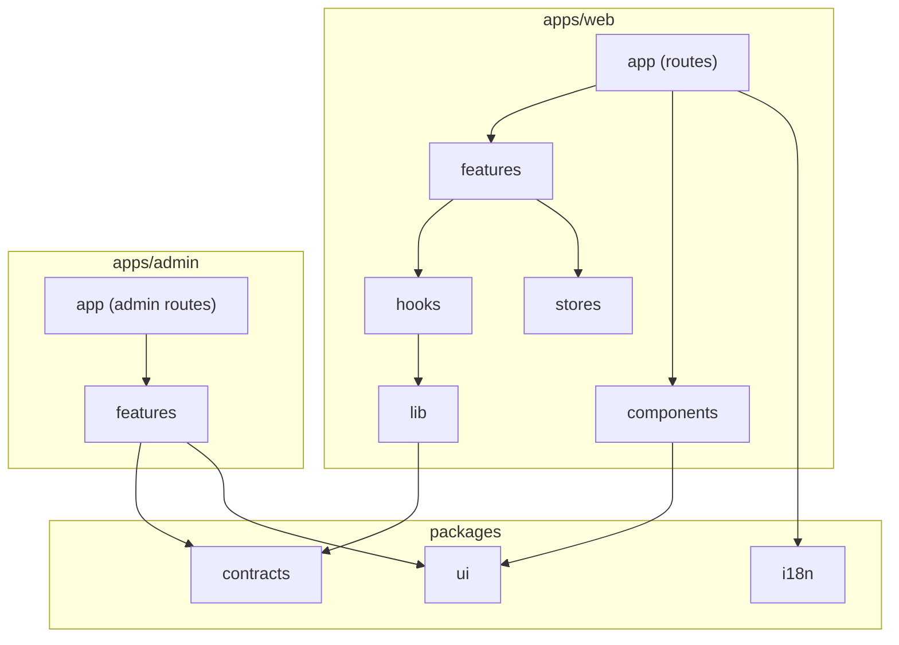

*Figure 1.2.1. Front-end package diagram*

Package descriptions

| No | Package | Description |
| --- | --- | --- |
| 01 | `apps/web/app` | Route theo App Router, chia nhóm `(public)` cho Guest (trang chủ, duyệt task, FAQ), `(auth)` cho đăng nhập OTP và `(app)` cho người đã đăng nhập (đăng task, My Tasks, My Work, Order Workspace, hồ sơ). |
| 02 | `apps/web/features` | Mỗi nghiệp vụ một thư mục: `auth`, `task`, `offer`, `order`, `review`, `verification`, `report`, `notification`. Chứa component màn hình, form và hook gọi API của nghiệp vụ đó. |
| 03 | `apps/web/components` | Thành phần dùng chung trong web: thẻ task, bộ lọc, khung chat, trình tải file, trạng thái rỗng. |
| 04 | `apps/web/hooks` | Hook dùng chung: `useSession`, `useRoleContext`, `useSocket`, `useInfiniteList`. |
| 05 | `apps/web/stores` | Store Zustand cho trạng thái giao diện (bộ lọc, ngữ cảnh Requester/Tasker). |
| 06 | `apps/web/lib` | Cấu hình HTTP client, làm mới token, xử lý mã lỗi chuẩn (`TASK_NOT_OPEN`, `RATE_LIMITED`...), định dạng tiền VND và thời gian theo múi giờ. |
| 07 | `apps/admin/app`, `features` | Trang quản trị: dashboard, hàng đợi xác minh, báo cáo, tranh chấp, người dùng, danh mục, FAQ, cấu hình, audit log. |
| 08 | `packages/contracts` | Schema Zod, kiểu TypeScript và API client sinh từ OpenAPI của back-end; một nguồn luật kiểm tra cho cả form và API. |
| 09 | `packages/ui` | Thư viện giao diện dùng chung (shadcn/ui + Tailwind token). |
| 10 | `packages/i18n` | Từ điển tiếng Việt, tiếng Anh và quy ước định dạng. |

#### 1.2.2 Back-end package diagram

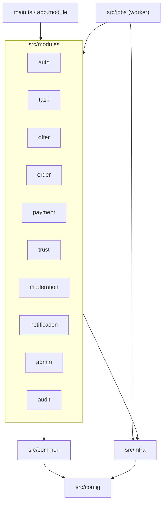

*Figure 1.2.2. Back-end package diagram*

Package descriptions

| No | Package | Description |
| --- | --- | --- |
| 01 | `/src/config` | Biến môi trường, kết nối DB, Redis, storage, cổng thanh toán; đọc qua `ConfigService`, không để khóa bí mật trong mã nguồn. |
| 02 | `/src/common` | Thành phần xuyên suốt: `guards` (JWT, RBAC), `policies` (kiểm quyền sở hữu chống IDOR), `interceptors` (idempotency, correlation ID), `filters` (mã lỗi chuẩn), `decorators`, `pipes`. |
| 03 | `/src/modules/<module>/controllers` | Nhận HTTP request, ánh xạ DTO, gọi service, trả response có phân trang. |
| 04 | `/src/modules/<module>/services` | Logic nghiệp vụ và máy trạng thái của module; mở giao dịch DB, ghi lịch sử, audit, outbox. |
| 05 | `/src/modules/<module>/repositories` | Truy vấn Kysely vào các bảng thuộc module; module khác không được ghi thẳng bảng này. |
| 06 | `/src/modules/<module>/dto` | DTO request/response và luật kiểm tra dữ liệu đầu vào. |
| 07 | `/src/modules/<module>/entities` | Kiểu dữ liệu tương ứng bảng DB và hằng số trạng thái. |
| 08 | `/src/modules/<module>/gateways` | Socket.IO gateway (chỉ có ở `order` và `notification`). |
| 09 | `/src/infra` | Adapter hạ tầng: `db` (Kysely, migration), `queue` (BullMQ), `storage` (S3, signed URL), `mail` (email, Zalo), `payment` (adapter PayOS, VNPAY, manual). |
| 10 | `/src/jobs` | Tiến trình worker: phát sự kiện outbox, hết hạn task, tự nghiệm thu order, quét file, nhắc hạn, cập nhật `user_stats`. |
| 11 | `/src/migrations` | Migration SQL có phiên bản, kiểm tra trong CI trước khi triển khai. |
| 12 | `/test` | Unit test máy trạng thái, tính phí; integration test DB; E2E theo kịch bản mục 15.2 SRS. |

## 2. Detailed Design

### 2.1 Authentication & Authorization

Truy vết: AUTH-01..04, mục 4.1, 9.1 SRS. Đăng nhập bằng email + OTP, không mật khẩu; access token JWT 15 phút, refresh token xoay vòng lưu dạng hash.

#### 2.1.1 Class Diagram

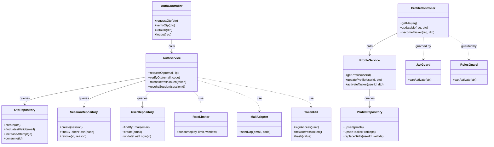

*Figure 2.1.1. Authentication & Authorization Class Diagram*

#### 2.1.2 Request OTP

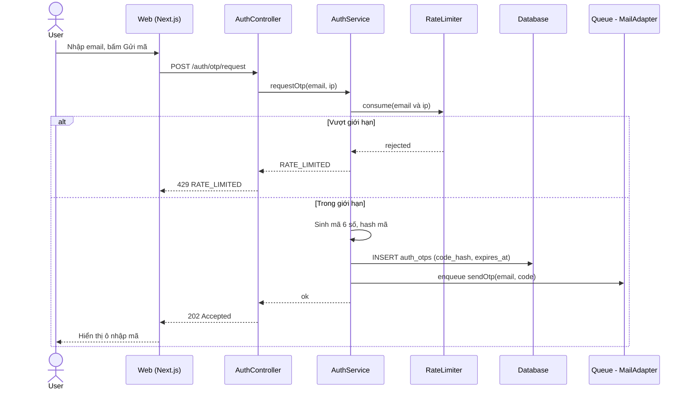

*Figure 2.1.2. Request OTP Sequence Diagram*

#### 2.1.3 Verify OTP & Sign In / Sign Up

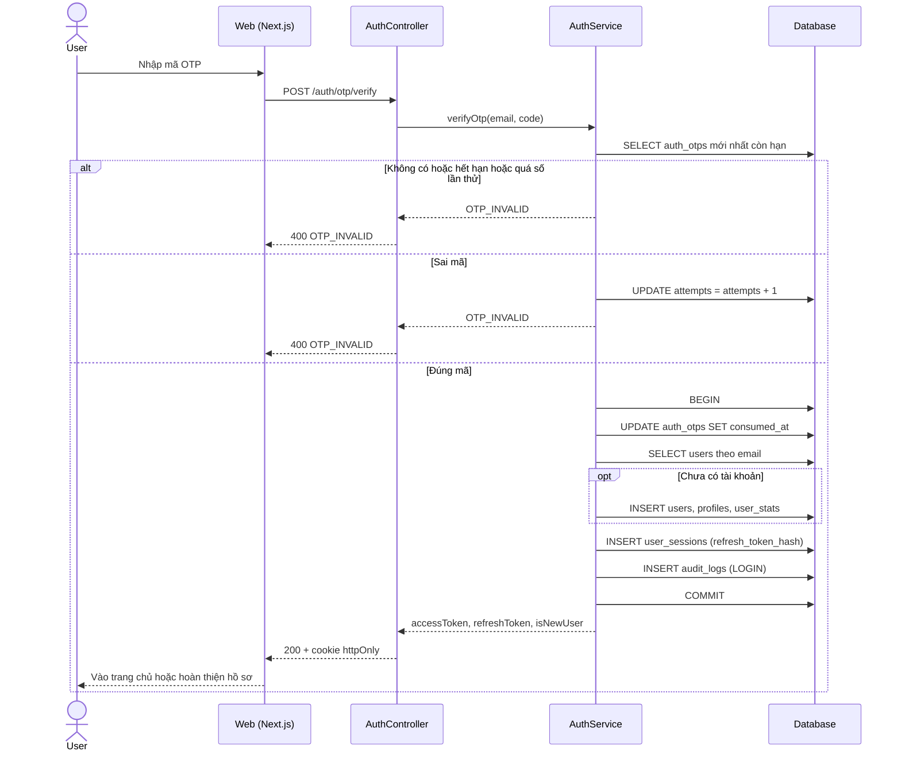

*Figure 2.1.3. Verify OTP & Sign In Sequence Diagram*

#### 2.1.4 Refresh Token & Sign Out

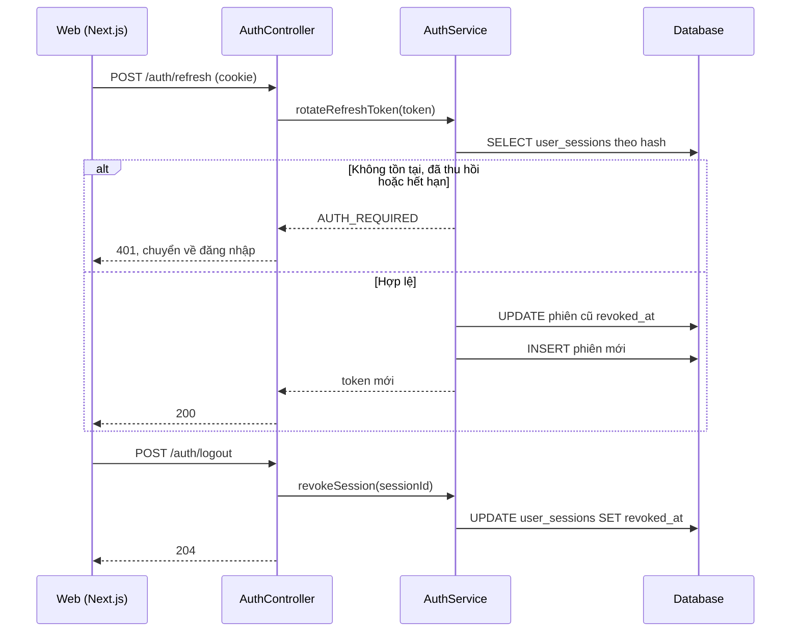

*Figure 2.1.4. Refresh Token & Sign Out Sequence Diagram*

#### 2.1.5 Update Profile

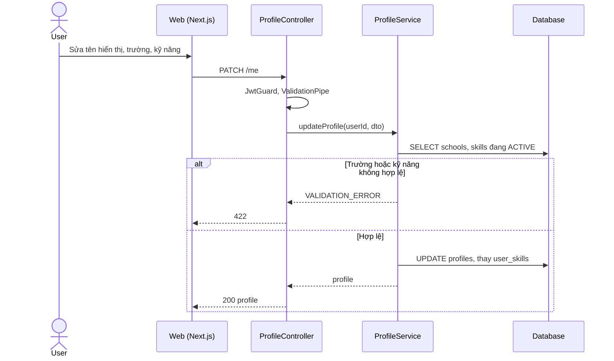

*Figure 2.1.5. Update Profile Sequence Diagram*

#### 2.1.6 Become Tasker

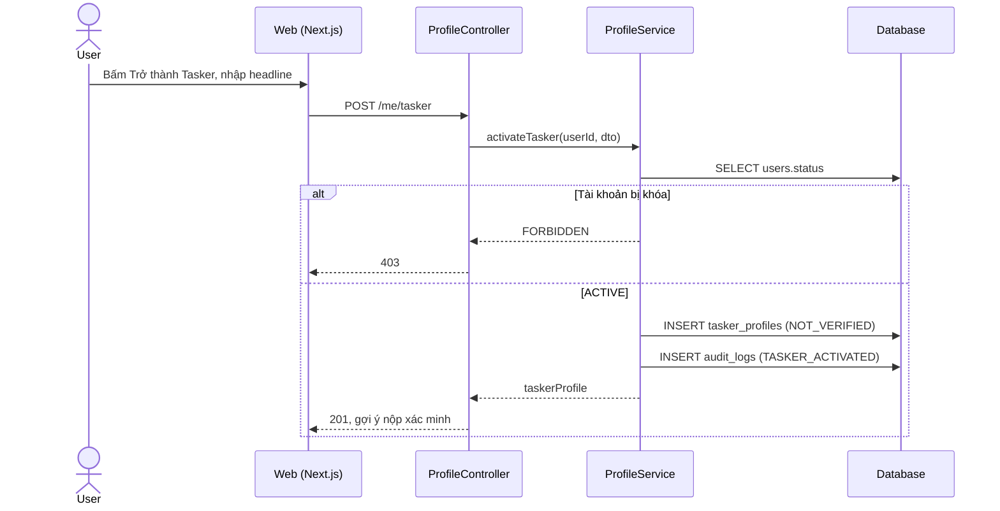

*Figure 2.1.6. Become Tasker Sequence Diagram*

### 2.2 Core Master Data Management

Truy vết: ADMIN-02, mục 10.1 SRS. Danh mục task, trường học và kỹ năng dùng chung một mẫu: Admin tạo, sửa, sắp xếp và ngừng dùng; không xóa cứng bản ghi đã được tham chiếu.

#### 2.2.1 Class Diagram

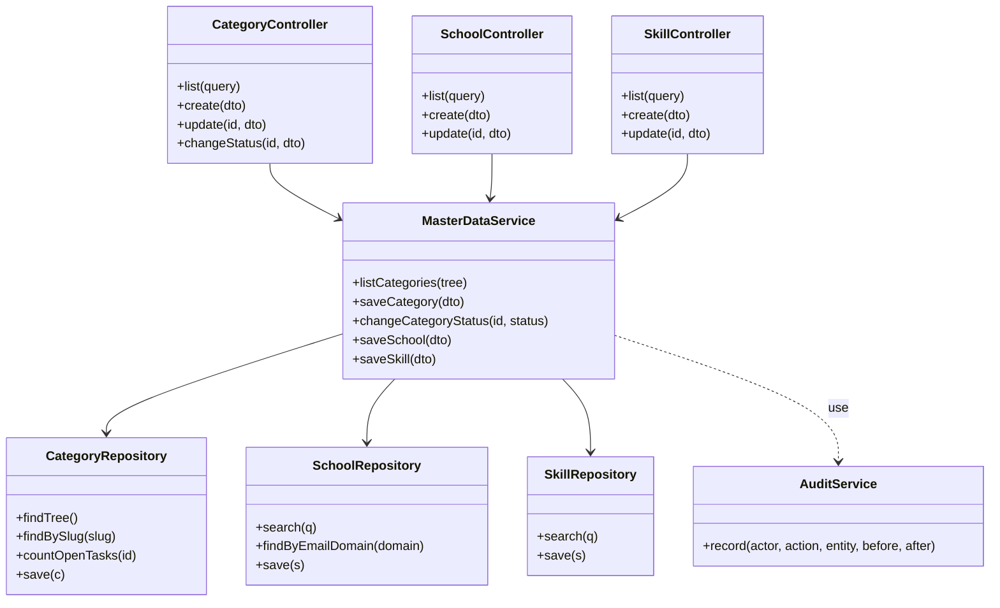

*Figure 2.2.1. Core Master Data Management Class Diagram*

#### 2.2.2 View List Category

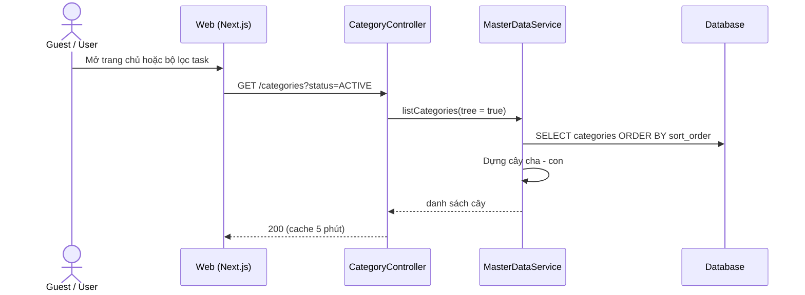

*Figure 2.2.2. View List Category Sequence Diagram*

#### 2.2.3 Create / Update Category

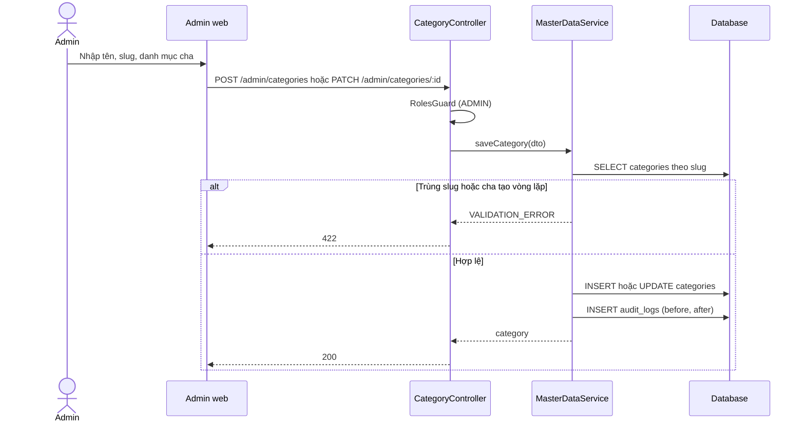

*Figure 2.2.3. Create / Update Category Sequence Diagram*

#### 2.2.4 Deactivate Category

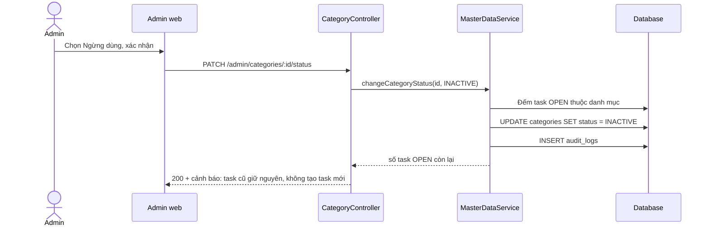

*Figure 2.2.4. Deactivate Category Sequence Diagram*

Trường học và kỹ năng dùng cùng luồng 2.2.2–2.2.4, đổi Controller và bảng tương ứng.

### 2.3 Task Management

Truy vết: TASK-01..05, DISC-01..02, mục 4.2, 5.1 SRS. Task chỉ giữ vòng đời trên chợ: DRAFT → OPEN → AWARDED → COMPLETED → CLOSED, nhánh CANCELLED và EXPIRED.

#### 2.3.1 Class Diagram

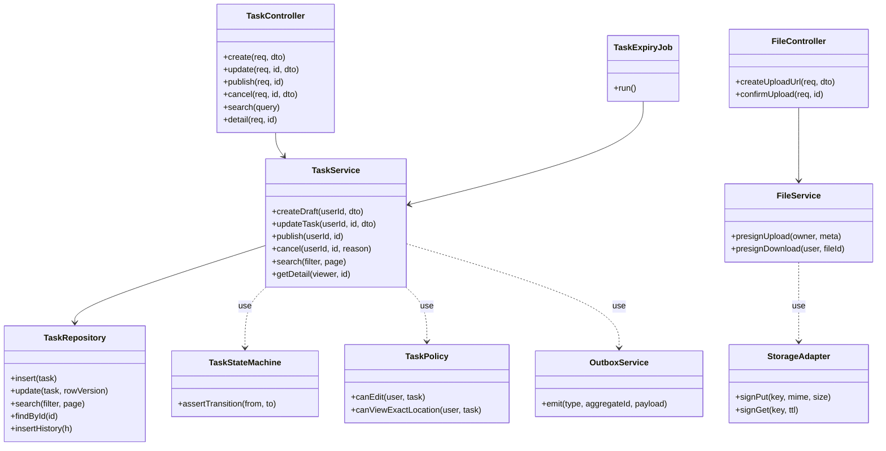

*Figure 2.3.1. Task Management Class Diagram*

#### 2.3.2 Create Task Draft & Upload Attachment

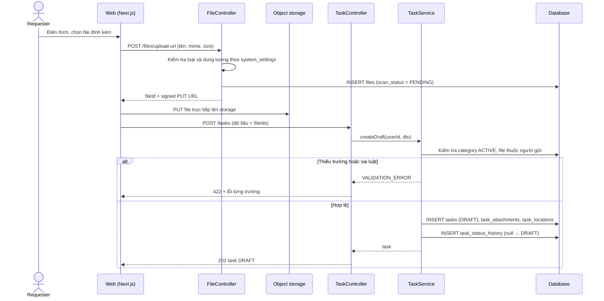

*Figure 2.3.2. Create Task Draft Sequence Diagram*

#### 2.3.3 Publish Task

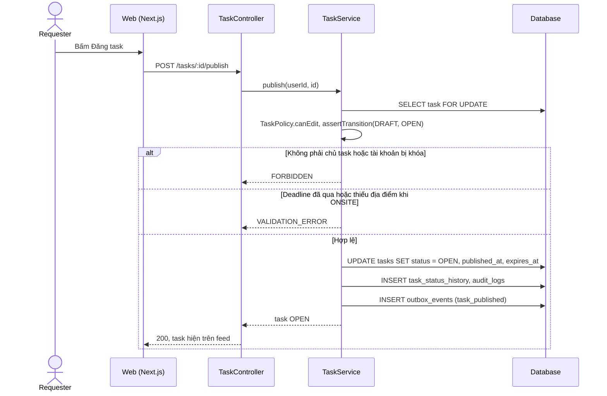

*Figure 2.3.3. Publish Task Sequence Diagram*

#### 2.3.4 Edit Task

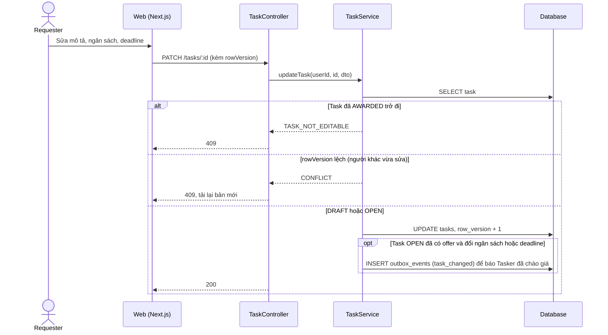

*Figure 2.3.4. Edit Task Sequence Diagram*

#### 2.3.5 Cancel Task

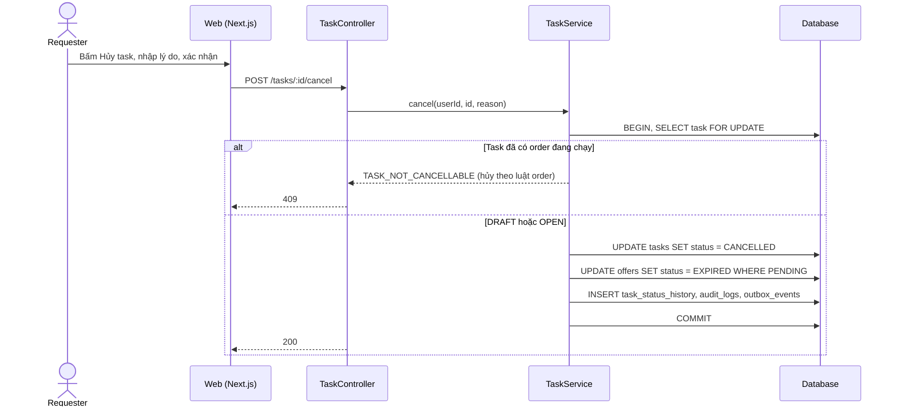

*Figure 2.3.5. Cancel Task Sequence Diagram*

#### 2.3.6 Search & Filter Tasks

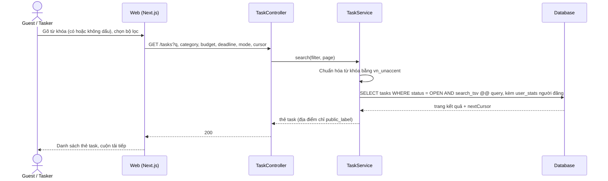

*Figure 2.3.6. Search & Filter Tasks Sequence Diagram*

#### 2.3.7 Auto-expire Tasks (scheduled job)

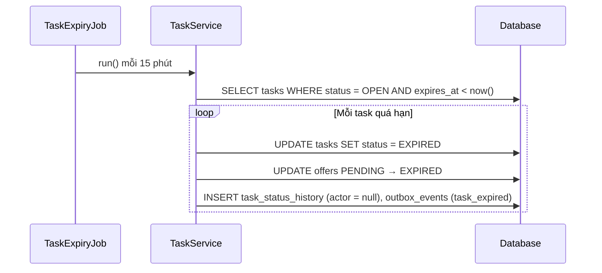

*Figure 2.3.7. Auto-expire Tasks Sequence Diagram*

### 2.4 Offer Management

Truy vết: OFFER-01..02, ORDER-01, mục 4.3, 5.2, BR-01 SRS. Hai luật được DB chặn trực tiếp: mỗi Tasker tối đa một offer PENDING trên một task, mỗi task tối đa một offer ACCEPTED.

#### 2.4.1 Class Diagram

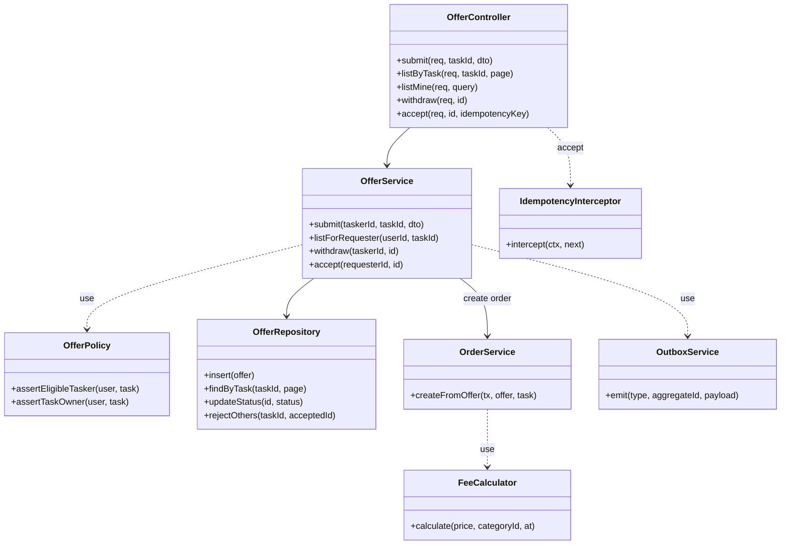

*Figure 2.4.1. Offer Management Class Diagram*

#### 2.4.2 Submit Offer

```mermaid
sequenceDiagram
  actor T as Tasker
  participant FE as Web (Next.js)
  participant C as OfferController
  participant S as OfferService
  participant DB as Database
  T->>FE: Nhập giá, thời điểm giao, lời nhắn
  FE->>C: POST /tasks/:id/offers
  C->>S: submit(taskerId, taskId, dto)
  S->>DB: SELECT task, tasker_profiles, users.status
  alt Chưa kích hoạt Tasker, bị khóa hoặc là chủ task
    S-->>C: OFFER_NOT_ELIGIBLE
    C-->>FE: 403
  else Task không còn OPEN
    S-->>C: TASK_NOT_OPEN
    C-->>FE: 409
  else Hợp lệ
    S->>DB: INSERT offers (PENDING, snapshot giá và hạn)
    alt Vi phạm offers_one_pending_uidx
      DB-->>S: unique violation
      S-->>C: OFFER_ALREADY_EXISTS
      C-->>FE: 409
    else Thành công
      S->>DB: UPDATE tasks SET offer_count + 1
      S->>DB: INSERT outbox_events (offer_submitted)
      C-->>FE: 201 offer PENDING
    end
  end
```

*Figure 2.4.2. Submit Offer Sequence Diagram*

#### 2.4.3 View Offers of a Task

```mermaid
sequenceDiagram
  actor R as Requester
  participant FE as Web (Next.js)
  participant C as OfferController
  participant S as OfferService
  participant DB as Database
  R->>FE: Mở task của mình, tab Offers
  FE->>C: GET /tasks/:id/offers?cursor
  C->>S: listForRequester(userId, taskId)
  S->>S: OfferPolicy.assertTaskOwner
  S->>DB: SELECT offers JOIN profiles, tasker_profiles, user_stats
  S-->>C: offer + uy tín Tasker (số sao, số đơn, xác minh)
  C-->>FE: 200 trang offer
  FE-->>R: So sánh giá, hạn giao, đánh giá
```

*Figure 2.4.3. View Offers Sequence Diagram*

#### 2.4.4 Withdraw Offer

```mermaid
sequenceDiagram
  actor T as Tasker
  participant FE as Web (Next.js)
  participant C as OfferController
  participant S as OfferService
  participant DB as Database
  T->>FE: Bấm Rút offer, xác nhận
  FE->>C: POST /offers/:id/withdraw
  C->>S: withdraw(taskerId, id)
  S->>DB: SELECT offer FOR UPDATE
  alt Không phải offer của mình hoặc không còn PENDING
    S-->>C: OFFER_NOT_ELIGIBLE
    C-->>FE: 409
  else PENDING
    S->>DB: UPDATE offers SET status = WITHDRAWN, decided_at
    S->>DB: UPDATE tasks SET offer_count - 1
    C-->>FE: 200, Tasker được gửi lại offer mới nếu task còn OPEN
  end
```

*Figure 2.4.4. Withdraw Offer Sequence Diagram*

#### 2.4.5 Accept Offer & Create Order

Thao tác nhạy cảm nhất của vòng giao dịch: một lần bấm tạo đúng một order, kể cả khi bấm đúp hoặc mạng gửi lại (mục 14 Recovery, 15.2 SRS).

```mermaid
sequenceDiagram
  actor R as Requester
  participant FE as Web (Next.js)
  participant I as IdempotencyInterceptor
  participant C as OfferController
  participant S as OfferService
  participant O as OrderService
  participant DB as Database
  R->>FE: Bấm Chấp nhận offer, xác nhận
  FE->>I: POST /offers/:id/accept + Idempotency-Key
  I->>DB: SELECT idempotency_keys (userId, key)
  alt Key đã xử lý
    I-->>FE: Trả lại response đã lưu (cùng orderId)
  else Key mới
    I->>C: chuyển tiếp
    C->>S: accept(requesterId, id)
    S->>DB: BEGIN, SELECT offer và task FOR UPDATE
    alt Không phải chủ task, task không OPEN hoặc offer không PENDING
      S->>DB: ROLLBACK
      S-->>C: OFFER_NOT_ELIGIBLE
    else Hợp lệ
      S->>DB: UPDATE offers SET status = ACCEPTED
      S->>DB: UPDATE offers khác PENDING → REJECTED
      S->>DB: UPDATE tasks SET status = AWARDED, awarded_at
      S->>O: createFromOffer(tx, offer, task)
      O->>O: FeeCalculator.calculate (fee_rules hiệu lực)
      O->>DB: INSERT orders (agreed_price, requester_fee, tasker_fee, due_at)
      O->>DB: INSERT conversations (ORDER) + participants
      O->>DB: INSERT order_status_history, audit_logs
      O->>DB: INSERT outbox_events (offer_accepted, offer_rejected)
      S->>DB: COMMIT
      S-->>C: order
    end
    C-->>I: response
    I->>DB: Lưu response vào idempotency_keys
    I-->>FE: 201 orderId
    FE-->>R: Chuyển vào Order Workspace
  end
```

*Figure 2.4.5. Accept Offer & Create Order Sequence Diagram*

Nếu hai request cùng lúc vượt qua lớp idempotency (khác key), index `orders_one_active_per_task_uidx` và `offers_one_accepted_uidx` làm giao dịch thứ hai thất bại, API trả `OFFER_NOT_ELIGIBLE`.

### 2.5 Order Workspace Management

Truy vết: ORDER-02..05, mục 4.4, 5.3, BR-04 SRS. Trạng thái công việc của order: IN\_PROGRESS → DELIVERED → (REVISION\_REQUESTED → DELIVERED)\* → COMPLETED; nhánh DISPUTED, CANCELLED. Chỉ hai bên của order và Staff/Admin được giao việc mới đọc được tin nhắn và file.

#### 2.5.1 Class Diagram

```mermaid
classDiagram
  class OrderController {
    +detail(req, id)
    +listMine(req, query)
    +submitDelivery(req, id, dto)
    +requestRevision(req, id, dto)
    +complete(req, id, idempotencyKey)
  }
  class ChatController {
    +listMessages(req, orderId, cursor)
    +send(req, orderId, dto)
  }
  class ChatGateway {
    +handleConnection(socket)
    +joinOrderRoom(socket, orderId)
    +broadcast(orderId, message)
  }
  class OrderService {
    +getDetail(user, id)
    +submitDelivery(taskerId, id, dto)
    +requestRevision(requesterId, id, reason)
    +complete(requesterId, id)
    +autoComplete(id)
  }
  class ChatService {
    +send(user, orderId, dto)
    +list(user, orderId, cursor)
    +markRead(user, orderId)
  }
  class OrderPolicy {
    +assertParticipant(user, order)
    +assertRequester(user, order)
    +assertTasker(user, order)
  }
  class OrderStateMachine {
    +assertTransition(from, to)
  }
  class OrderRepository {
    +findById(id)
    +lockById(tx, id)
    +updateStatus(tx, id, status, fields)
    +insertHistory(tx, h)
  }
  class DeliveryRepository {
    +nextVersion(orderId)
    +insert(tx, d)
    +supersedeOpen(tx, orderId)
    +accept(tx, id)
  }
  class MessageRepository {
    +insert(m)
    +page(conversationId, cursor)
  }
  class PaymentService {
    +releaseForOrder(tx, order)
  }
  class AutoCompleteJob {
    +run()
  }
  OrderController --> OrderService
  ChatController --> ChatService
  ChatGateway --> ChatService
  OrderService --> OrderRepository
  OrderService --> DeliveryRepository
  OrderService ..> OrderPolicy : use
  OrderService ..> OrderStateMachine : use
  OrderService --> PaymentService : release funds
  ChatService --> MessageRepository
  ChatService ..> OrderPolicy : use
  AutoCompleteJob --> OrderService
```

*Figure 2.5.1. Order Workspace Management Class Diagram*

#### 2.5.2 View Order Detail

```mermaid
sequenceDiagram
  actor U as Requester / Tasker
  participant FE as Web (Next.js)
  participant C as OrderController
  participant S as OrderService
  participant DB as Database
  U->>FE: Mở Order Workspace
  FE->>C: GET /orders/:id
  C->>S: getDetail(user, id)
  S->>DB: SELECT orders, task, deliveries, order_status_history
  S->>S: OrderPolicy.assertParticipant
  alt Không phải người trong order (đổi ID trên URL)
    S-->>C: FORBIDDEN
    C-->>FE: 403, không lộ dữ liệu order
  else Là người trong order
    S-->>C: order, timeline, địa chỉ chính xác nếu ONSITE, nút hành động hợp lệ
    C-->>FE: 200 (header noindex)
  end
```

*Figure 2.5.2. View Order Detail Sequence Diagram*

#### 2.5.3 Send Message

```mermaid
sequenceDiagram
  actor U as Requester / Tasker
  participant FE as Web (Next.js)
  participant G as ChatGateway
  participant S as ChatService
  participant DB as Database
  participant P as Đối tác (socket)
  U->>FE: Gõ tin nhắn, đính kèm file
  FE->>G: emit message.send (orderId, body, fileIds)
  G->>S: send(user, orderId, dto)
  S->>S: OrderPolicy.assertParticipant, RateLimiter
  alt Conversation đã khóa hoặc vượt giới hạn
    S-->>G: ORDER_NOT_ELIGIBLE hoặc RATE_LIMITED
    G-->>FE: ack lỗi
  else Hợp lệ
    S->>DB: INSERT messages, message_attachments
    S->>DB: INSERT outbox_events (message_sent)
    S-->>G: message
    G-->>FE: ack ok
    G-->>P: broadcast vào room order
  end
```

*Figure 2.5.3. Send Message Sequence Diagram*

#### 2.5.4 Submit Delivery

```mermaid
sequenceDiagram
  actor T as Tasker
  participant FE as Web (Next.js)
  participant C as OrderController
  participant S as OrderService
  participant DB as Database
  T->>FE: Tải file kết quả, ghi chú bàn giao
  FE->>C: POST /orders/:id/deliveries
  C->>S: submitDelivery(taskerId, id, dto)
  S->>DB: BEGIN, lockById(order)
  S->>S: assertTasker, assertTransition(IN_PROGRESS hoặc REVISION_REQUESTED, DELIVERED)
  alt Sai trạng thái
    S-->>C: ORDER_NOT_ELIGIBLE
    C-->>FE: 409
  else Hợp lệ
    S->>DB: INSERT deliveries (version = n + 1, SUBMITTED), delivery_files
    S->>DB: UPDATE orders SET status = DELIVERED, delivered_at, auto_complete_at
    S->>DB: INSERT order_status_history, outbox_events (delivery_submitted)
    S->>DB: COMMIT
    C-->>FE: 201 delivery
  end
```

*Figure 2.5.4. Submit Delivery Sequence Diagram*

#### 2.5.5 Request Revision

```mermaid
sequenceDiagram
  actor R as Requester
  participant FE as Web (Next.js)
  participant C as OrderController
  participant S as OrderService
  participant DB as Database
  R->>FE: Bấm Yêu cầu sửa, nhập lý do
  FE->>C: POST /orders/:id/revision
  C->>S: requestRevision(requesterId, id, reason)
  S->>DB: BEGIN, lockById(order)
  alt Không phải DELIVERED hoặc đã hết số lần sửa (max_revisions)
    S-->>C: ORDER_NOT_ELIGIBLE
    C-->>FE: 409, gợi ý mở tranh chấp
  else Hợp lệ
    S->>DB: UPDATE deliveries bản mới nhất SET status = REVISION_REQUESTED, revision_reason
    S->>DB: UPDATE orders SET status = REVISION_REQUESTED, revision_count + 1, auto_complete_at = null
    S->>DB: INSERT order_status_history, outbox_events (revision_requested)
    S->>DB: COMMIT
    C-->>FE: 200
  end
```

*Figure 2.5.5. Request Revision Sequence Diagram*

#### 2.5.6 Accept Delivery & Complete Order

```mermaid
sequenceDiagram
  actor R as Requester
  participant FE as Web (Next.js)
  participant C as OrderController
  participant S as OrderService
  participant P as PaymentService
  participant DB as Database
  R->>FE: Bấm Nghiệm thu, xác nhận
  FE->>C: POST /orders/:id/complete + Idempotency-Key
  C->>S: complete(requesterId, id)
  S->>DB: BEGIN, lockById(order)
  alt Không phải DELIVERED hoặc đang tranh chấp
    S-->>C: ORDER_NOT_ELIGIBLE
    C-->>FE: 409
  else Hợp lệ
    S->>DB: UPDATE deliveries bản mới nhất SET status = ACCEPTED
    S->>DB: UPDATE orders SET status = COMPLETED, completed_at
    S->>DB: UPDATE tasks SET status = COMPLETED
    S->>P: releaseForOrder(tx, order)
    P->>DB: INSERT ledger_transactions + ledger_entries (RELEASE, FEE)
    S->>DB: UPDATE conversations SET locked_at
    S->>DB: INSERT order_status_history, audit_logs, outbox_events (order_completed)
    S->>DB: COMMIT
    C-->>FE: 200
    FE-->>R: Hiện form đánh giá Tasker
  end
```

*Figure 2.5.6. Accept Delivery & Complete Order Sequence Diagram*

#### 2.5.7 Auto-complete Order (scheduled job)

```mermaid
sequenceDiagram
  participant J as AutoCompleteJob
  participant S as OrderService
  participant DB as Database
  J->>S: run() mỗi 15 phút
  S->>DB: SELECT orders WHERE status = DELIVERED AND auto_complete_at < now()
  loop Mỗi order đến hạn
    S->>S: autoComplete(id) theo cùng luồng 2.5.6, actor = SYSTEM
    S->>DB: INSERT outbox_events (order_auto_completed) để báo cả hai bên
  end
```

*Figure 2.5.7. Auto-complete Order Sequence Diagram*

Thời hạn tự nghiệm thu và số lần sửa tối đa là quyết định sản phẩm còn mở; hệ thống đọc từ `system_settings`.

#### 2.5.8 Download Private File

```mermaid
sequenceDiagram
  actor U as Requester / Tasker
  participant FE as Web (Next.js)
  participant C as FileController
  participant S as FileService
  participant DB as Database
  participant ST as Object storage
  U->>FE: Bấm tải file bàn giao
  FE->>C: GET /files/:id/download-url
  C->>S: presignDownload(user, fileId)
  S->>DB: Tìm đối tượng chứa file (task, message, delivery) và kiểm quyền
  alt Không có quyền hoặc file bị nhiễm mã độc
    S-->>C: FORBIDDEN
    C-->>FE: 403
  else Có quyền
    S->>ST: signGet(storage_key, 5 phút)
    S-->>C: URL có hạn
    C-->>FE: 200 url
    FE->>ST: GET file
  end
```

*Figure 2.5.8. Download Private File Sequence Diagram*

### 2.6 Billing, Payment & Fee

Truy vết: BR-02, BR-03, BR-07, mục 11 SRS. Thiết kế hỗ trợ cả phương án A (cổng thanh toán, giữ tiền đến khi nghiệm thu) và phương án B (chuyển khoản, Admin xác nhận chứng từ) qua một interface `PaymentGateway`. Mọi biến động tiền đều ghi vào sổ cái kép, tổng bút toán mỗi giao dịch bằng 0.

#### 2.6.1 Class Diagram

```mermaid
classDiagram
  class PaymentController {
    +createPayIn(req, orderId, idempotencyKey)
    +uploadTransferProof(req, paymentId, dto)
  }
  class WebhookController {
    +handle(provider, headers, body)
  }
  class AdminPaymentController {
    +confirmManual(req, paymentId)
    +createPayout(req, orderId)
    +createRefund(req, orderId, dto)
    +reconcile(req, query)
  }
  class FeeRuleController {
    +list()
    +createVersion(req, dto)
  }
  class PaymentService {
    +createPayIn(user, orderId)
    +onProviderEvent(event)
    +confirmManual(admin, paymentId)
    +releaseForOrder(tx, order)
    +payout(admin, orderId)
    +refund(admin, orderId, amount)
  }
  class LedgerService {
    +post(tx, kind, entries)
    +balanceOf(account, userId)
  }
  class FeeCalculator {
    +calculate(price, categoryId, at)
  }
  class PaymentGateway {
    <<interface>>
    +createCheckout(payment)
    +verifySignature(headers, body)
    +parseEvent(body)
    +createPayout(payment)
  }
  class PayOSAdapter
  class VnpayAdapter
  class ManualTransferAdapter
  class PaymentRepository {
    +insert(p)
    +updateStatus(tx, id, status)
    +findByProviderRef(provider, ref)
  }
  class WebhookEventRepository {
    +insertIfNew(provider, eventId, payload)
    +markProcessed(id)
  }
  PaymentController --> PaymentService
  WebhookController --> PaymentService
  AdminPaymentController --> PaymentService
  FeeRuleController --> FeeCalculator
  PaymentService --> PaymentRepository
  PaymentService --> WebhookEventRepository
  PaymentService --> LedgerService
  PaymentService ..> PaymentGateway : use
  PaymentGateway <|.. PayOSAdapter
  PaymentGateway <|.. VnpayAdapter
  PaymentGateway <|.. ManualTransferAdapter
```

*Figure 2.6.1. Billing, Payment & Fee Class Diagram*

Sơ đồ tài khoản sổ cái dùng trong các bút toán:

| Nghiệp vụ | Bút toán (dương = Nợ, âm = Có) |
| --- | --- |
| Thu tiền Requester (CHARGE + HOLD) | PROVIDER\_CLEARING +total, ESCROW −total |
| Nghiệm thu (RELEASE + FEE) | ESCROW +total, TASKER\_PAYABLE −payout, PLATFORM\_REVENUE −(requester\_fee + tasker\_fee) |
| Chi cho Tasker (PAYOUT) | TASKER\_PAYABLE +payout, PROVIDER\_CLEARING −payout |
| Hoàn tiền (REFUND) | ESCROW +amount, REQUESTER\_REFUNDABLE −amount, sau đó chi trả qua cổng |

#### 2.6.2 Create Pay-in (Gateway)

```mermaid
sequenceDiagram
  actor R as Requester
  participant FE as Web (Next.js)
  participant C as PaymentController
  participant S as PaymentService
  participant G as PaymentGateway
  participant DB as Database
  R->>FE: Bấm Thanh toán cho order AWAITING_PAYMENT
  FE->>C: POST /orders/:id/payments + Idempotency-Key
  C->>S: createPayIn(user, orderId)
  S->>DB: SELECT order, payments PENDING
  alt Đã có payment PENDING còn hạn
    S-->>C: trả lại checkoutUrl cũ
  else Tạo mới
    S->>DB: INSERT payments (PAY_IN, amount = requester_total, PENDING)
    S->>G: createCheckout(payment)
    G-->>S: checkoutUrl, provider_ref
    S->>DB: UPDATE payments SET provider_ref
    S-->>C: checkoutUrl
  end
  C-->>FE: 200 checkoutUrl
  FE-->>R: Chuyển sang trang thanh toán của cổng
  Note over FE: Trang kết quả phía client không được đánh dấu đã trả, chỉ webhook mới có hiệu lực
```

*Figure 2.6.2. Create Pay-in Sequence Diagram*

#### 2.6.3 Handle Payment Webhook

```mermaid
sequenceDiagram
  participant PV as Cổng thanh toán
  participant C as WebhookController
  participant S as PaymentService
  participant G as PaymentGateway
  participant DB as Database
  PV->>C: POST /webhooks/payments/:provider
  C->>G: verifySignature(headers, body)
  alt Chữ ký sai
    C->>DB: INSERT payment_webhook_events (signature_valid = false)
    C-->>PV: 401
  else Chữ ký đúng
    C->>S: onProviderEvent(event)
    S->>DB: INSERT payment_webhook_events ON CONFLICT (provider, event_id) DO NOTHING
    alt Sự kiện đã xử lý (gửi lại)
      S-->>C: bỏ qua
    else Sự kiện mới
      S->>DB: BEGIN, SELECT payment theo provider_ref FOR UPDATE
      alt Thanh toán thành công, số tiền khớp
        S->>DB: UPDATE payments SET status = SUCCEEDED
        S->>DB: LedgerService.post (CHARGE, HOLD)
        S->>DB: UPDATE orders SET payment_status = HELD, status = IN_PROGRESS, started_at
        S->>DB: INSERT outbox_events (payment_succeeded)
      else Thất bại hoặc hết hạn
        S->>DB: UPDATE payments SET status = FAILED hoặc EXPIRED
        S->>DB: UPDATE orders SET payment_status = FAILED
      end
      S->>DB: UPDATE payment_webhook_events SET processed_at, COMMIT
    end
    C-->>PV: 200
  end
```

*Figure 2.6.3. Handle Payment Webhook Sequence Diagram*

#### 2.6.4 Confirm Manual Transfer (phương án B)

```mermaid
sequenceDiagram
  actor R as Requester
  actor A as Admin
  participant FE as Web / Admin web
  participant C as Payment / AdminPayment Controller
  participant S as PaymentService
  participant DB as Database
  R->>FE: Tải ảnh chứng từ chuyển khoản
  FE->>C: POST /payments/:id/proof
  C->>S: lưu proof_file_id, payment vẫn PENDING
  A->>FE: Mở hàng đợi đối soát, đối chiếu sao kê
  FE->>C: POST /admin/payments/:id/confirm
  C->>S: confirmManual(admin, paymentId)
  S->>DB: BEGIN, UPDATE payments SET SUCCEEDED, confirmed_by
  S->>DB: LedgerService.post (CHARGE, HOLD)
  S->>DB: UPDATE orders SET payment_status = HELD, status = IN_PROGRESS
  S->>DB: INSERT audit_logs (PAYMENT_CONFIRMED), COMMIT
  C-->>FE: 200
```

*Figure 2.6.4. Confirm Manual Transfer Sequence Diagram*

#### 2.6.5 Payout to Tasker

```mermaid
sequenceDiagram
  actor A as Admin / Finance
  participant FE as Admin web
  participant C as AdminPaymentController
  participant S as PaymentService
  participant G as PaymentGateway
  participant DB as Database
  A->>FE: Chọn order COMPLETED, payment_status = RELEASED
  FE->>C: POST /admin/orders/:id/payout + Idempotency-Key
  C->>S: payout(admin, orderId)
  S->>DB: Kiểm tra số dư TASKER_PAYABLE của Tasker đủ tasker_payout
  S->>DB: INSERT payments (PAYOUT, PENDING)
  S->>G: createPayout(payment) hoặc ghi nhận chuyển tay
  G-->>S: kết quả
  S->>DB: UPDATE payments SET SUCCEEDED, LedgerService.post (PAYOUT)
  S->>DB: INSERT audit_logs, outbox_events (payout_sent)
  C-->>FE: 200
```

*Figure 2.6.5. Payout to Tasker Sequence Diagram*

#### 2.6.6 Refund

Hoàn tiền chỉ phát sinh từ kết luận tranh chấp (2.8.5) hoặc hủy order trước khi làm việc; người dùng không tự gọi được.

```mermaid
sequenceDiagram
  participant D as DisputeService
  participant S as PaymentService
  participant G as PaymentGateway
  participant DB as Database
  D->>S: refund(admin, orderId, amount)
  S->>DB: BEGIN, kiểm tra amount không vượt số đang giữ trong ESCROW
  S->>DB: INSERT payments (REFUND, PENDING)
  S->>DB: LedgerService.post (REFUND)
  S->>DB: UPDATE orders SET payment_status = REFUNDED hoặc PARTIALLY_REFUNDED
  S->>DB: INSERT audit_logs, COMMIT
  S->>G: createPayout(refund) về tài khoản Requester
  G-->>S: kết quả qua webhook (luồng 2.6.3)
```

*Figure 2.6.6. Refund Sequence Diagram*

#### 2.6.7 Create Fee Rule Version

```mermaid
sequenceDiagram
  actor A as Admin
  participant FE as Admin web
  participant C as FeeRuleController
  participant DB as Database
  A->>FE: Nhập tỷ lệ phí bên đăng, bên làm, ngày hiệu lực
  FE->>C: POST /admin/fee-rules
  C->>DB: BEGIN
  C->>DB: UPDATE fee_rules phiên bản hiện hành SET effective_to
  C->>DB: INSERT fee_rules (version + 1)
  C->>DB: INSERT audit_logs, COMMIT
  C-->>FE: 201
  Note over DB: Order cũ giữ fee_rule_id và số tiền phí đã chốt, không tính lại
```

*Figure 2.6.7. Create Fee Rule Version Sequence Diagram*

### 2.7 Trust, Review & Tasker Verification

Truy vết: TRUST-01..02, VERIFY-01, BR-05, mục 12.1 SRS. Đánh giá chỉ được tạo từ order COMPLETED, mỗi bên một lần. Xác minh Tasker giữ toàn bộ lịch sử duyệt; giấy tờ chỉ Admin xem được.

#### 2.7.1 Class Diagram

```mermaid
classDiagram
  class ReviewController {
    +create(req, orderId, dto)
    +listForUser(userId, query)
  }
  class PublicProfileController {
    +get(userId)
  }
  class VerificationController {
    +submit(req, dto)
    +requestSchoolEmailOtp(req, dto)
    +confirmSchoolEmail(req, dto)
    +getMine(req)
  }
  class AdminVerificationController {
    +queue(query)
    +detail(id)
    +decide(req, id, dto)
    +revoke(req, userId, dto)
  }
  class ReviewService {
    +create(user, orderId, dto)
    +publishBlind(orderId)
  }
  class VerificationService {
    +submit(user, dto)
    +verifySchoolEmail(user, email, code)
    +decide(admin, id, decision, reason)
    +revoke(admin, userId, reason)
    +expireDue()
  }
  class TrustStatsService {
    +recompute(userId)
  }
  class ReviewRepository {
    +insert(r)
    +findByOrder(orderId)
    +pageForReviewee(userId, cursor)
  }
  class VerificationRepository {
    +insert(v, evidence)
    +findOpen(userId)
    +updateDecision(tx, id, status)
  }
  class UserStatsRepository {
    +upsert(stats)
  }
  ReviewController --> ReviewService
  PublicProfileController --> TrustStatsService
  VerificationController --> VerificationService
  AdminVerificationController --> VerificationService
  ReviewService --> ReviewRepository
  VerificationService --> VerificationRepository
  TrustStatsService --> UserStatsRepository
  ReviewService ..> TrustStatsService : outbox event
```

*Figure 2.7.1. Trust, Review & Tasker Verification Class Diagram*

#### 2.7.2 Submit Review

```mermaid
sequenceDiagram
  actor U as Requester / Tasker
  participant FE as Web (Next.js)
  participant C as ReviewController
  participant S as ReviewService
  participant DB as Database
  U->>FE: Chọn số sao, viết nhận xét
  FE->>C: POST /orders/:id/reviews
  C->>S: create(user, orderId, dto)
  S->>DB: SELECT order
  alt Order chưa COMPLETED hoặc người gửi không thuộc order
    S-->>C: ORDER_NOT_ELIGIBLE
    C-->>FE: 409
  else Hợp lệ
    S->>S: Xác định reviewee và direction (TO_TASKER hoặc TO_REQUESTER)
    S->>DB: INSERT reviews (status theo cấu hình hiển thị)
    alt Vi phạm unique (order_id, reviewer_id)
      S-->>C: REVIEW_ALREADY_EXISTS
      C-->>FE: 409
    else Thành công
      opt Chế độ ẩn chờ cả hai bên và bên kia đã đánh giá
        S->>DB: UPDATE reviews của order SET status = PUBLISHED
      end
      S->>DB: INSERT outbox_events (review_submitted)
      C-->>FE: 201
    end
  end
```

*Figure 2.7.2. Submit Review Sequence Diagram*

#### 2.7.3 View Public Profile

```mermaid
sequenceDiagram
  actor U as Guest / User
  participant FE as Web (Next.js)
  participant C as PublicProfileController
  participant S as TrustStatsService
  participant DB as Database
  U->>FE: Bấm tên người đăng hoặc Tasker
  FE->>C: GET /users/:id/public-profile
  C->>S: get(userId)
  S->>DB: SELECT profiles, schools, user_skills, tasker_profiles.verification_status
  S->>DB: SELECT user_stats, reviews PUBLISHED mới nhất
  S-->>C: hồ sơ công khai (không email, không giấy tờ)
  C-->>FE: 200
```

*Figure 2.7.3. View Public Profile Sequence Diagram*

#### 2.7.4 Submit Tasker Verification

```mermaid
sequenceDiagram
  actor T as Tasker
  participant FE as Web (Next.js)
  participant C as VerificationController
  participant S as VerificationService
  participant DB as Database
  T->>FE: Chọn loại bằng chứng, tải thẻ sinh viên hoặc chứng chỉ
  FE->>C: POST /verifications (evidence + fileIds)
  C->>S: submit(user, dto)
  S->>DB: SELECT tasker_verifications đang mở
  alt Đã có yêu cầu PENDING hoặc NEED_MORE_INFO
    S-->>C: VERIFICATION_IN_PROGRESS
    C-->>FE: 409
  else Chưa có
    S->>DB: INSERT tasker_verifications (PENDING), verification_evidence (purge_after)
    S->>DB: UPDATE tasker_profiles SET verification_status = PENDING
    S->>DB: INSERT outbox_events (verification_submitted) để vào hàng đợi Admin
    C-->>FE: 201
  end
```

*Figure 2.7.4. Submit Tasker Verification Sequence Diagram*

#### 2.7.5 Verify School Email

```mermaid
sequenceDiagram
  actor T as Tasker
  participant FE as Web (Next.js)
  participant C as VerificationController
  participant S as VerificationService
  participant DB as Database
  participant Q as Queue - MailAdapter
  T->>FE: Nhập email trường
  FE->>C: POST /verifications/school-email/request
  C->>S: tách tên miền
  S->>DB: SELECT schools WHERE email_domain
  alt Tên miền không thuộc trường nào
    S-->>C: SCHOOL_DOMAIN_UNKNOWN
    C-->>FE: 422, chuyển sang nộp giấy tờ
  else Khớp trường
    S->>DB: INSERT auth_otps (purpose = CHANGE_EMAIL)
    S->>Q: sendOtp(email trường)
    C-->>FE: 202
    T->>FE: Nhập mã
    FE->>C: POST /verifications/school-email/confirm
    C->>S: verifySchoolEmail(user, email, code)
    S->>DB: INSERT verification_evidence (SCHOOL_EMAIL), UPDATE profiles.school_id
    C-->>FE: 200, bằng chứng được gắn vào yêu cầu xác minh
  end
```

*Figure 2.7.5. Verify School Email Sequence Diagram*

#### 2.7.6 Admin Review Verification

```mermaid
sequenceDiagram
  actor A as Admin
  participant FE as Admin web
  participant C as AdminVerificationController
  participant S as VerificationService
  participant DB as Database
  A->>FE: Mở hàng đợi xác minh, xem bằng chứng (URL có hạn)
  A->>FE: Chọn Duyệt, Từ chối hoặc Cần thêm thông tin, nhập lý do
  FE->>C: POST /admin/verifications/:id/decision
  C->>S: decide(admin, id, decision, reason)
  S->>DB: BEGIN, SELECT verification FOR UPDATE
  alt APPROVED
    S->>DB: UPDATE tasker_verifications SET APPROVED, reviewer_id, expires_at
    S->>DB: UPDATE tasker_profiles SET VERIFIED, verified_until
  else REJECTED
    S->>DB: UPDATE tasker_verifications SET REJECTED, decision_reason
    S->>DB: UPDATE tasker_profiles SET REJECTED
  else NEED_MORE_INFO
    S->>DB: UPDATE tasker_verifications SET NEED_MORE_INFO, decision_reason
  end
  S->>DB: INSERT audit_logs, outbox_events (verification_decided), COMMIT
  C-->>FE: 200
```

*Figure 2.7.6. Admin Review Verification Sequence Diagram*

#### 2.7.7 Recompute Trust Stats (worker)

```mermaid
sequenceDiagram
  participant W as Outbox worker
  participant S as TrustStatsService
  participant DB as Database
  W->>S: sự kiện order_completed hoặc review_submitted
  S->>DB: Đếm order hoàn thành, tổng sao, số đơn đúng hạn, số tranh chấp thua
  S->>DB: UPSERT user_stats
  Note over S,DB: Thẻ task và hồ sơ đọc user_stats, không tính lại mỗi lần xem
```

*Figure 2.7.7. Recompute Trust Stats Sequence Diagram*

### 2.8 Moderation & Dispute Management

Truy vết: MOD-01..02, BR-06, BR-07, mục 3.4, 12.2, 12.3 SRS. Báo cáo (report) xử lý vi phạm nội dung và tài khoản; tranh chấp (dispute) xử lý bất đồng trong order và quyết định dòng tiền. Mọi quyết định đều ghi `moderation_actions` và `audit_logs`.

#### 2.8.1 Class Diagram

```mermaid
classDiagram
  class ReportController {
    +create(req, dto)
    +listMine(req)
  }
  class AdminReportController {
    +queue(query)
    +detail(id)
    +assign(req, id, staffId)
    +resolve(req, id, dto)
  }
  class AdminUserController {
    +suspend(req, userId, dto)
    +unsuspend(req, userId)
  }
  class DisputeController {
    +open(req, orderId, dto)
  }
  class AdminDisputeController {
    +queue(query)
    +resolve(req, id, dto)
  }
  class ReportService {
    +create(user, dto)
    +assign(staff, id, assignee)
    +resolve(actor, id, decision)
  }
  class ModerationService {
    +apply(actor, action, target, reason, until)
    +revert(actor, actionId)
  }
  class DisputeService {
    +open(user, orderId, dto)
    +resolve(admin, id, resolution)
  }
  class SnapshotBuilder {
    +build(targetType, targetId)
  }
  class ReportRepository
  class ModerationActionRepository
  class DisputeRepository
  class PaymentService {
    +releaseForOrder(tx, order)
    +refund(admin, orderId, amount)
  }
  ReportController --> ReportService
  AdminReportController --> ReportService
  AdminUserController --> ModerationService
  DisputeController --> DisputeService
  AdminDisputeController --> DisputeService
  ReportService ..> SnapshotBuilder : use
  ReportService --> ReportRepository
  ReportService --> ModerationService
  ModerationService --> ModerationActionRepository
  DisputeService --> DisputeRepository
  DisputeService --> PaymentService
```

*Figure 2.8.1. Moderation & Dispute Management Class Diagram*

#### 2.8.2 Create Report

```mermaid
sequenceDiagram
  actor U as User
  participant FE as Web (Next.js)
  participant C as ReportController
  participant S as ReportService
  participant B as SnapshotBuilder
  participant DB as Database
  U->>FE: Bấm Báo cáo trên task, offer, tin nhắn, bàn giao, đánh giá hoặc người dùng
  FE->>C: POST /reports (targetType, targetId, reportType, mô tả)
  C->>S: create(user, dto)
  S->>S: RateLimiter, kiểm tra người báo cáo được xem đối tượng
  S->>B: build(targetType, targetId)
  B->>DB: Đọc nội dung hiện tại của đối tượng
  B-->>S: context_snapshot
  S->>DB: INSERT reports (OPEN, severity theo reportType)
  alt Đã có báo cáo đang mở của cùng người cho cùng đối tượng
    DB-->>S: unique violation
    S-->>C: REPORT_ALREADY_OPEN
    C-->>FE: 409
  else Thành công
    S->>DB: INSERT outbox_events (report_created)
    C-->>FE: 201, hiển thị mã báo cáo
  end
```

*Figure 2.8.2. Create Report Sequence Diagram*

#### 2.8.3 Triage & Assign Report

```mermaid
sequenceDiagram
  actor ST as Staff
  participant FE as Admin web
  participant C as AdminReportController
  participant S as ReportService
  participant DB as Database
  ST->>FE: Mở hàng đợi, lọc theo mức độ, loại
  FE->>C: GET /admin/reports?status=OPEN
  C->>DB: SELECT reports ORDER BY severity DESC, created_at
  ST->>FE: Mở báo cáo, xem snapshot, giao người xử lý
  FE->>C: POST /admin/reports/:id/assign
  C->>S: assign(staff, id, assignee)
  S->>DB: UPDATE reports SET status = TRIAGED, assigned_to
  S->>DB: INSERT audit_logs
  C-->>FE: 200
```

*Figure 2.8.3. Triage & Assign Report Sequence Diagram*

#### 2.8.4 Resolve Report & Apply Moderation Action

```mermaid
sequenceDiagram
  actor A as Admin
  participant FE as Admin web
  participant C as AdminReportController
  participant S as ReportService
  participant M as ModerationService
  participant DB as Database
  A->>FE: Chọn kết luận và hành động (ẩn nội dung, cảnh cáo, khóa tài khoản), nhập lý do
  FE->>C: POST /admin/reports/:id/resolve
  C->>S: resolve(admin, id, decision)
  S->>DB: BEGIN
  alt Báo cáo không có căn cứ
    S->>DB: UPDATE reports SET status = DISMISSED, resolution_note
  else Có vi phạm
    S->>M: apply(admin, action, target, reason, until)
    M->>DB: INSERT moderation_actions
    alt HIDE_CONTENT hoặc REMOVE_CONTENT
      M->>DB: UPDATE đối tượng (tasks.moderation_state, messages.hidden_at, reviews.status)
    else SUSPEND_USER
      M->>DB: UPDATE users SET status = SUSPENDED
      M->>DB: UPDATE user_sessions SET revoked_at
    end
    S->>DB: UPDATE reports SET status = RESOLVED, public_outcome
  end
  S->>DB: INSERT audit_logs, outbox_events (report_resolved), COMMIT
  C-->>FE: 200
```

*Figure 2.8.4. Resolve Report Sequence Diagram*

Người bị khóa không tạo được task, offer, order mới (BR-06). Order đang chạy của họ được chuyển sang tranh chấp để Admin quyết định tiếp tục hay hủy; đây là mặc định đề xuất, cần Product Owner xác nhận.

#### 2.8.5 Open Dispute

```mermaid
sequenceDiagram
  actor U as Requester / Tasker
  participant FE as Web (Next.js)
  participant C as DisputeController
  participant S as DisputeService
  participant DB as Database
  U->>FE: Bấm Mở tranh chấp, chọn lý do, mô tả, xác nhận
  FE->>C: POST /orders/:id/dispute
  C->>S: open(user, orderId, dto)
  S->>DB: BEGIN, SELECT order FOR UPDATE
  alt Không phải người trong order hoặc order đã COMPLETED, CANCELLED
    S-->>C: ORDER_NOT_ELIGIBLE
    C-->>FE: 409
  else Hợp lệ
    S->>DB: INSERT disputes (OPEN)
    S->>DB: UPDATE orders SET status = DISPUTED, auto_complete_at = null
    S->>DB: INSERT order_status_history, audit_logs, outbox_events (dispute_opened)
    S->>DB: COMMIT
    C-->>FE: 201, tiền tiếp tục được giữ
  end
```

*Figure 2.8.5. Open Dispute Sequence Diagram*

#### 2.8.6 Resolve Dispute

```mermaid
sequenceDiagram
  actor A as Admin
  participant FE as Admin web
  participant C as AdminDisputeController
  participant S as DisputeService
  participant P as PaymentService
  participant DB as Database
  A->>FE: Xem timeline order, tin nhắn, các bản bàn giao
  A->>FE: Chọn kết luận, nhập lý do
  FE->>C: POST /admin/disputes/:id/resolve
  C->>S: resolve(admin, id, resolution)
  S->>DB: BEGIN
  alt RELEASE_TO_TASKER
    S->>DB: UPDATE orders SET status = COMPLETED
    S->>P: releaseForOrder(tx, order)
  else REFUND_REQUESTER
    S->>DB: UPDATE orders SET status = CANCELLED
    S->>P: refund(admin, orderId, toàn bộ)
  else SPLIT
    S->>P: refund(admin, orderId, refund_amount)
    S->>P: releaseForOrder(tx, phần còn lại)
  else CONTINUE_WORK
    S->>DB: UPDATE orders SET status = IN_PROGRESS
  end
  S->>DB: UPDATE disputes SET RESOLVED, resolution, resolved_by
  S->>DB: INSERT moderation_actions, audit_logs, outbox_events (dispute_resolved), COMMIT
  C-->>FE: 200
```

*Figure 2.8.6. Resolve Dispute Sequence Diagram*

### 2.9 Notification Management

Truy vết: NOTIF-01, mục 13, 16 SRS. Thông báo không gửi trực tiếp từ nghiệp vụ: mỗi module ghi sự kiện vào `outbox_events` trong cùng giao dịch, worker đọc ra rồi tạo thông báo trong ứng dụng, email hoặc Zalo theo cài đặt của người dùng.

#### 2.9.1 Class Diagram

```mermaid
classDiagram
  class NotificationController {
    +list(req, cursor)
    +unreadCount(req)
    +markRead(req, id)
    +markAllRead(req)
    +getPreferences(req)
    +updatePreferences(req, dto)
  }
  class NotificationGateway {
    +pushToUser(userId, notification)
  }
  class OutboxDispatcher {
    +poll()
    +dispatch(event)
  }
  class NotificationService {
    +fromEvent(event)
    +createInApp(userId, type, title, body, entity)
    +list(userId, cursor)
    +markRead(userId, id)
  }
  class TemplateRenderer {
    +render(type, locale, data)
  }
  class PreferenceRepository {
    +channelsFor(userId, type)
    +upsert(userId, prefs)
  }
  class NotificationRepository {
    +insert(n)
    +page(userId, cursor)
    +markRead(userId, id)
  }
  class MailAdapter {
    +send(to, subject, html)
  }
  class ZaloAdapter {
    +sendZns(phone, templateId, data)
  }
  class AnalyticsSink {
    +track(event)
  }
  NotificationController --> NotificationService
  OutboxDispatcher --> NotificationService
  OutboxDispatcher --> AnalyticsSink
  NotificationService --> NotificationRepository
  NotificationService --> PreferenceRepository
  NotificationService ..> TemplateRenderer : use
  NotificationService ..> NotificationGateway : push
  NotificationService ..> MailAdapter : queue job
  NotificationService ..> ZaloAdapter : queue job
```

*Figure 2.9.1. Notification Management Class Diagram*

Sự kiện phát thông báo và người nhận:

| Sự kiện outbox | Người nhận | Kênh mặc định |
| --- | --- | --- |
| offer\_submitted | Requester | In-app, email |
| offer\_accepted, offer\_rejected | Tasker | In-app, email |
| message\_sent | Bên còn lại trong order | In-app (gộp nếu đang online) |
| delivery\_submitted | Requester | In-app, email |
| revision\_requested | Tasker | In-app, email |
| order\_completed, order\_auto\_completed | Cả hai bên | In-app, email |
| payment\_succeeded, payout\_sent | Bên liên quan | In-app, email |
| verification\_decided | Tasker | In-app, email |
| report\_resolved, dispute\_resolved | Người báo cáo, hai bên order | In-app, email |
| task\_expired | Requester | In-app |

#### 2.9.2 Dispatch Notification (System Auto Notification)

```mermaid
sequenceDiagram
  participant W as OutboxDispatcher (worker)
  participant S as NotificationService
  participant DB as Database
  participant Q as Queue (BullMQ)
  participant G as NotificationGateway
  participant U as Người nhận (đang online)
  loop Mỗi 2 giây
    W->>DB: SELECT outbox_events WHERE published_at IS NULL LIMIT 100 FOR UPDATE SKIP LOCKED
    W->>S: fromEvent(event)
    S->>DB: SELECT notification_preferences của người nhận
    S->>DB: INSERT notifications (in-app)
    S->>G: pushToUser(userId, notification)
    G-->>U: sự kiện notification.new
    opt Kênh email hoặc Zalo được bật
      S->>Q: enqueue gửi email hoặc Zalo (có retry)
    end
    W->>DB: UPDATE outbox_events SET published_at
  end
```

*Figure 2.9.2. Dispatch Notification Sequence Diagram*

#### 2.9.3 User View Notification List

```mermaid
sequenceDiagram
  actor U as User
  participant FE as Web (Next.js)
  participant C as NotificationController
  participant S as NotificationService
  participant DB as Database
  U->>FE: Bấm biểu tượng chuông
  FE->>C: GET /notifications?cursor
  C->>S: list(userId, cursor)
  S->>DB: SELECT notifications WHERE user_id ORDER BY created_at DESC
  S-->>C: trang thông báo + số chưa đọc
  C-->>FE: 200
  FE-->>U: Danh sách, bấm vào mở đúng task hoặc order
```

*Figure 2.9.3. User View Notification List Sequence Diagram*

#### 2.9.4 User Mark Notifications

```mermaid
sequenceDiagram
  actor U as User
  participant FE as Web (Next.js)
  participant C as NotificationController
  participant S as NotificationService
  participant DB as Database
  alt Đánh dấu một thông báo
    U->>FE: Mở một thông báo
    FE->>C: PATCH /notifications/:id/read
    C->>S: markRead(userId, id)
    S->>DB: UPDATE notifications SET read_at WHERE id AND user_id
  else Đánh dấu tất cả
    U->>FE: Bấm Đánh dấu đã đọc tất cả
    FE->>C: POST /notifications/read-all
    C->>S: markAllRead(userId)
    S->>DB: UPDATE notifications SET read_at WHERE user_id AND read_at IS NULL
  end
  C-->>FE: 204
```

*Figure 2.9.4. User Mark Notifications Sequence Diagram*

#### 2.9.5 Update Notification Preferences

```mermaid
sequenceDiagram
  actor U as User
  participant FE as Web (Next.js)
  participant C as NotificationController
  participant DB as Database
  U->>FE: Bật hoặc tắt email, Zalo theo từng loại thông báo
  FE->>C: PUT /notifications/preferences
  C->>DB: UPSERT notification_preferences (user_id, type, channel, enabled)
  C-->>FE: 200
  Note over C,DB: Thông báo in-app cho sự kiện tiền và tranh chấp luôn bật, không tắt được
```

*Figure 2.9.5. Update Notification Preferences Sequence Diagram*

### 2.10 Admin, Internal Account, Configuration & FAQ

Truy vết: ADMIN-01, SUP-01, mục 10.1 SRS. Staff và Admin là vai trò cấp thêm cho một tài khoản User (bảng `user_roles`), không phải loại tài khoản riêng. Mọi thay đổi cấu hình đều ghi audit kèm giá trị trước và sau.

#### 2.10.1 Class Diagram

```mermaid
classDiagram
  class DashboardController {
    +kpis(range)
    +queues()
  }
  class AdminUserController {
    +search(query)
    +detail(userId)
    +grantRole(req, userId, dto)
    +revokeRole(req, userId, role)
  }
  class SettingsController {
    +list()
    +update(req, key, dto)
  }
  class FaqController {
    +publicList(query)
    +publicDetail(slug)
    +create(req, dto)
    +update(req, id, dto)
    +changeStatus(req, id, status)
  }
  class DashboardService {
    +kpis(range)
    +queueCounts()
  }
  class AdminUserService {
    +search(query)
    +detail(userId)
    +grantRole(admin, userId, role)
    +revokeRole(admin, userId, role)
  }
  class SettingsService {
    +get(key)
    +update(admin, key, value)
  }
  class FaqService {
    +save(staff, dto)
    +publish(staff, id)
    +unpublish(staff, id)
  }
  class SettingsCache {
    +invalidate(key)
  }
  class AuditService {
    +record(actor, action, entity, before, after)
  }
  DashboardController --> DashboardService
  AdminUserController --> AdminUserService
  SettingsController --> SettingsService
  FaqController --> FaqService
  SettingsService ..> SettingsCache : use
  AdminUserService ..> AuditService : use
  SettingsService ..> AuditService : use
  FaqService ..> AuditService : use
```

*Figure 2.10.1. Admin, Internal Account, Configuration & FAQ Class Diagram*

#### 2.10.2 View Dashboard & Queues

```mermaid
sequenceDiagram
  actor A as Admin
  participant FE as Admin web
  participant C as DashboardController
  participant S as DashboardService
  participant DB as Database
  A->>FE: Mở Dashboard, chọn khoảng thời gian
  FE->>C: GET /admin/dashboard?from&to
  C->>S: kpis(range), queueCounts()
  S->>DB: Task OPEN có 0 offer và có offer, thời gian đến offer đầu tiên
  S->>DB: Tỷ lệ hoàn thành, tỷ lệ tranh chấp, giá trị giao dịch
  S->>DB: Đếm hàng đợi: xác minh, báo cáo, tranh chấp, thanh toán chờ đối soát
  S-->>C: số liệu
  C-->>FE: 200
```

*Figure 2.10.2. View Dashboard & Queues Sequence Diagram*

#### 2.10.3 Search User & View History

```mermaid
sequenceDiagram
  actor A as Admin / Staff
  participant FE as Admin web
  participant C as AdminUserController
  participant S as AdminUserService
  participant DB as Database
  A->>FE: Tìm theo email, tên, mã order
  FE->>C: GET /admin/users?q
  C->>S: search(query)
  S->>DB: SELECT users JOIN profiles (phân trang)
  A->>FE: Mở một người dùng
  FE->>C: GET /admin/users/:id
  C->>S: detail(userId)
  S->>DB: Task, order, báo cáo liên quan, moderation_actions, audit_logs
  alt Staff
    S-->>C: ẩn email đầy đủ và giấy tờ xác minh
  else Admin
    S-->>C: đầy đủ
  end
  C-->>FE: 200
```

*Figure 2.10.3. Search User & View History Sequence Diagram*

#### 2.10.4 Create Internal Account (Grant Staff / Admin Role)

```mermaid
sequenceDiagram
  actor A as Admin
  participant FE as Admin web
  participant C as AdminUserController
  participant S as AdminUserService
  participant DB as Database
  A->>FE: Chọn người dùng, cấp vai trò STAFF hoặc ADMIN
  FE->>C: POST /admin/users/:id/roles
  C->>C: RolesGuard (ADMIN)
  C->>S: grantRole(admin, userId, role)
  alt Tự cấp cho chính mình
    S-->>C: FORBIDDEN
  else Hợp lệ
    S->>DB: INSERT user_roles (granted_by)
    S->>DB: UPDATE user_sessions SET revoked_at (buộc đăng nhập lại để nhận quyền mới)
    S->>DB: INSERT audit_logs (ROLE_GRANTED)
    C-->>FE: 200
  end
```

*Figure 2.10.4. Grant Staff / Admin Role Sequence Diagram*

Thu hồi vai trò dùng cùng luồng, ghi `revoked_at` thay vì xóa dòng.

#### 2.10.5 Update System Configuration

```mermaid
sequenceDiagram
  actor A as Admin
  participant FE as Admin web
  participant C as SettingsController
  participant S as SettingsService
  participant DB as Database
  participant K as SettingsCache
  A->>FE: Sửa giá trị (OTP TTL, dung lượng file, hạn tự nghiệm thu, số lần sửa)
  FE->>C: PUT /admin/settings/:key
  C->>S: update(admin, key, value)
  S->>S: Kiểm tra kiểu và miền giá trị theo schema của key
  S->>DB: SELECT giá trị cũ
  S->>DB: UPDATE system_settings, INSERT audit_logs (before, after)
  S->>K: invalidate(key)
  C-->>FE: 200
```

*Figure 2.10.5. Update System Configuration Sequence Diagram*

Phí nền tảng không nằm trong `system_settings` mà quản lý theo phiên bản ở 2.6.7.

#### 2.10.6 Manage FAQ

```mermaid
sequenceDiagram
  actor ST as Staff
  participant FE as Admin web
  participant C as FaqController
  participant S as FaqService
  participant DB as Database
  ST->>FE: Viết câu hỏi, câu trả lời, chọn nhóm
  FE->>C: POST /admin/faq
  C->>S: save(staff, dto)
  S->>DB: INSERT faq_posts (DRAFT, author_staff_id)
  ST->>FE: Bấm Xuất bản
  FE->>C: PATCH /admin/faq/:id/status
  C->>S: publish(staff, id)
  S->>DB: UPDATE faq_posts SET status = PUBLISHED, published_at
  S->>DB: INSERT audit_logs
  C-->>FE: 200, bài hiện ở /faq với nhãn Trả lời chính thức
```

*Figure 2.10.6. Manage FAQ Sequence Diagram*

### 2.11 System Monitoring & Audit

Truy vết: ADMIN-03, BR-07, BR-08, mục 9 (Observability), 10.2 SRS. `audit_logs` chỉ được thêm: trigger trong DB từ chối mọi UPDATE và DELETE. Mỗi request mang một correlation ID xuyên suốt log ứng dụng, audit và Sentry.

#### 2.11.1 Class Diagram

```mermaid
classDiagram
  class AuditLogController {
    +search(req, query)
    +detail(req, id)
  }
  class HealthController {
    +liveness()
    +readiness()
  }
  class CorrelationIdInterceptor {
    +intercept(ctx, next)
  }
  class AuditService {
    +record(tx, actor, action, entity, before, after, meta)
    +search(filter, cursor)
  }
  class AuditRepository {
    +insert(tx, log)
    +page(filter, cursor)
  }
  class AppLogger {
    +info(msg, ctx)
    +error(err, ctx)
  }
  class ErrorTracker {
    +capture(err, ctx)
  }
  class MetricsExporter {
    +observeRequest(route, status, ms)
    +observeQueue(name, depth)
  }
  class GlobalExceptionFilter {
    +catch(err, host)
  }
  AuditLogController --> AuditService
  AuditService --> AuditRepository
  CorrelationIdInterceptor ..> AppLogger : use
  CorrelationIdInterceptor ..> MetricsExporter : use
  GlobalExceptionFilter ..> ErrorTracker : use
  GlobalExceptionFilter ..> AppLogger : use
  HealthController ..> MetricsExporter : use
```

*Figure 2.11.1. System Monitoring & Audit Class Diagram*

#### 2.11.2 Record Audit Event

```mermaid
sequenceDiagram
  participant I as CorrelationIdInterceptor
  participant S as Service nghiệp vụ
  participant A as AuditService
  participant DB as Database
  I->>I: Gắn correlationId (từ header hoặc sinh mới)
  I->>S: gọi xử lý trong ngữ cảnh request
  S->>DB: BEGIN, đọc bản ghi trước khi đổi
  S->>DB: UPDATE nghiệp vụ
  S->>A: record(tx, actor, action, entity, before, after, correlationId)
  A->>DB: INSERT audit_logs (cùng giao dịch)
  S->>DB: COMMIT
  Note over A,DB: Nếu nghiệp vụ rollback thì audit cũng rollback, không có bản ghi audit cho thao tác không xảy ra
```

*Figure 2.11.2. Record Audit Event Sequence Diagram*

#### 2.11.3 View Audit Logs

```mermaid
sequenceDiagram
  actor A as Admin
  participant FE as Admin web
  participant C as AuditLogController
  participant S as AuditService
  participant DB as Database
  A->>FE: Lọc theo người thực hiện, loại đối tượng, mã đối tượng, khoảng thời gian
  FE->>C: GET /admin/audit-logs?actor, entityType, entityId, from, to, cursor
  C->>C: RolesGuard (ADMIN có quyền xem audit)
  C->>S: search(filter, cursor)
  S->>DB: SELECT audit_logs theo index (entity_type, entity_id) hoặc (actor_id)
  S-->>C: trang bản ghi, ẩn trường nhạy cảm trong before và after
  C-->>FE: 200
  FE-->>A: Dòng thời gian, xem chi tiết trước và sau
```

*Figure 2.11.3. View Audit Logs Sequence Diagram*

#### 2.11.4 Error Tracking & Health Check

```mermaid
sequenceDiagram
  participant FE as Web (Next.js)
  participant F as GlobalExceptionFilter
  participant L as AppLogger
  participant E as ErrorTracker (Sentry)
  participant M as Giám sát hạ tầng
  participant H as HealthController
  FE->>F: request gặp lỗi chưa lường trước
  F->>L: error(err, correlationId, route, userId)
  F->>E: capture(err, ngữ cảnh đã lược bỏ OTP, token, nội dung tin nhắn)
  F-->>FE: 500 INTERNAL_ERROR + correlationId để người dùng báo hỗ trợ
  loop Định kỳ
    M->>H: GET /health/ready
    H-->>M: trạng thái DB, Redis, storage, độ sâu hàng đợi
  end
```

*Figure 2.11.4. Error Tracking & Health Check Sequence Diagram*

## 3. Database Design

Cơ sở dữ liệu gồm 45 bảng trên PostgreSQL 16, khớp với file `vietvi_schema_v0_1.sql` đã chạy thử. Quy ước: khóa chính UUID, tiền là `bigint` đơn vị đồng, thời gian `timestamptz` lưu UTC, trạng thái là `text` có ràng buộc CHECK. ERD được chia bốn hình theo nhóm nghiệp vụ, mỗi hình chỉ hiện khóa và quan hệ; cột đầy đủ nằm trong phần Table Descriptions.

### Database Schema

#### ERD 1 – Identity, Profile & Verification

```mermaid
erDiagram
  USERS ||--|| PROFILES : has
  USERS ||--o{ USER_ROLES : granted
  USERS ||--o{ USER_SESSIONS : opens
  USERS ||--o{ USER_SKILLS : has
  SKILLS ||--o{ USER_SKILLS : tagged
  SCHOOLS ||--o{ PROFILES : studies_at
  USERS ||--o| TASKER_PROFILES : becomes
  USERS ||--o{ TASKER_VERIFICATIONS : submits
  TASKER_VERIFICATIONS ||--o{ VERIFICATION_EVIDENCE : includes
  FILES ||--o{ VERIFICATION_EVIDENCE : stores
  USERS ||--o{ FILES : owns
  USERS {
    uuid id PK
    citext email UK
  }
  PROFILES {
    uuid user_id PK, FK
    uuid school_id FK
    uuid avatar_file_id FK
  }
  TASKER_VERIFICATIONS {
    uuid id PK
    uuid user_id FK
    uuid reviewer_id FK
  }
  VERIFICATION_EVIDENCE {
    uuid id PK
    uuid verification_id FK
    uuid file_id FK
  }
```

*Figure 3.0.1. ERD – Identity, Profile & Verification (12 bảng; `auth_otps` độc lập, tra theo email)*

#### ERD 2 – Marketplace Core

```mermaid
erDiagram
  CATEGORIES ||--o{ CATEGORIES : parent_of
  CATEGORIES ||--o{ TASKS : classifies
  USERS ||--o{ TASKS : posts
  TASKS ||--o| TASK_LOCATIONS : located
  TASKS ||--o{ TASK_ATTACHMENTS : has
  TASKS ||--o{ TASK_STATUS_HISTORY : logs
  TASKS ||--o{ OFFERS : receives
  USERS ||--o{ OFFERS : submits
  OFFERS ||--o{ OFFER_ATTACHMENTS : has
  OFFERS ||--o| ORDERS : becomes
  TASKS ||--o{ ORDERS : fulfilled_by
  ORDERS ||--o{ ORDER_STATUS_HISTORY : logs
  ORDERS ||--o{ DELIVERIES : receives
  DELIVERIES ||--o{ DELIVERY_FILES : has
  ORDERS ||--o| CONVERSATIONS : chat
  CONVERSATIONS ||--o{ CONVERSATION_PARTICIPANTS : includes
  CONVERSATIONS ||--o{ MESSAGES : contains
  MESSAGES ||--o{ MESSAGE_ATTACHMENTS : has
  TASKS {
    uuid id PK
    uuid requester_id FK
    uuid category_id FK
  }
  OFFERS {
    uuid id PK
    uuid task_id FK
    uuid tasker_id FK
  }
  ORDERS {
    uuid id PK
    uuid offer_id FK, UK
    uuid task_id FK
    uuid requester_id FK
    uuid tasker_id FK
  }
  DELIVERIES {
    uuid id PK
    uuid order_id FK
  }
```

*Figure 3.0.2. ERD – Marketplace Core (15 bảng)*

#### ERD 3 – Payment, Ledger & Dispute

```mermaid
erDiagram
  FEE_RULES ||--o{ ORDERS : prices
  ORDERS ||--o{ PAYMENTS : paid_by
  PAYMENTS ||--o{ LEDGER_TRANSACTIONS : posts
  ORDERS ||--o{ LEDGER_TRANSACTIONS : about
  LEDGER_TRANSACTIONS ||--|{ LEDGER_ENTRIES : balanced_by
  ORDERS ||--o{ DISPUTES : disputed_in
  DISPUTES ||--o{ MODERATION_ACTIONS : leads_to
  PAYMENT_WEBHOOK_EVENTS }o--|| PAYMENTS : about_provider_ref
  PAYMENTS {
    uuid id PK
    uuid order_id FK
    text idempotency_key UK
  }
  LEDGER_ENTRIES {
    bigint id PK
    uuid transaction_id FK
    text account_code
    bigint amount
  }
```

*Figure 3.0.3. ERD – Payment, Ledger & Dispute (6 bảng + orders)*

#### ERD 4 – Trust, Moderation, Notification & Operations

```mermaid
erDiagram
  ORDERS ||--o{ REVIEWS : reviewed_in
  USERS ||--o{ REVIEWS : receives
  USERS ||--|| USER_STATS : summarized
  USERS ||--o{ REPORTS : files
  REPORTS ||--o{ MODERATION_ACTIONS : leads_to
  USERS ||--o{ NOTIFICATIONS : receives
  USERS ||--o{ NOTIFICATION_PREFERENCES : sets
  FAQ_CATEGORIES ||--o{ FAQ_POSTS : groups
  USERS ||--o{ FAQ_POSTS : authors
  USERS ||--o{ AUDIT_LOGS : acts
  USERS ||--o{ IDEMPOTENCY_KEYS : sends
  REVIEWS {
    uuid id PK
    uuid order_id FK
    uuid reviewer_id FK
    uuid reviewee_id FK
  }
  REPORTS {
    uuid id PK
    uuid reporter_id FK
    text target_type
    uuid target_id
  }
```

*Figure 3.0.4. ERD – Trust, Moderation, Notification & Operations (`system_settings`, `outbox_events` độc lập)*

### Ràng buộc nghiệp vụ do DB đảm bảo

| Ràng buộc | Cách thực hiện | Truy vết |
| --- | --- | --- |
| Mỗi Tasker tối đa 1 offer PENDING trên 1 task | Unique index có điều kiện `offers_one_pending_uidx` | 4.3 |
| Mỗi task tối đa 1 offer ACCEPTED | `offers_one_accepted_uidx` | BR-01 |
| Mỗi task tối đa 1 order không bị hủy | `orders_one_active_per_task_uidx` | BR-01 |
| Mỗi order tối đa 1 bản giao ACCEPTED | `deliveries_one_accepted_uidx` | 4.4 |
| Mỗi order tối đa 1 tranh chấp đang mở | `disputes_one_open_uidx` | 3.4 |
| Mỗi bên đánh giá 1 lần mỗi order | Unique `(order_id, reviewer_id)` | TRUST-02 |
| Sổ cái cân bằng | Constraint trigger `ledger_balanced_trg` kiểm khi COMMIT | Mục 11 |
| Audit không sửa, không xóa | Trigger `audit_logs_no_update` | 10.2 |
| Webhook không xử lý lặp | Unique `(provider, event_id)` | Mục 11 |
| Tiền không dùng số thực | Cột `bigint`, tổng do cột sinh `requester_total`, `tasker_payout` | BR-02 |

### Table Descriptions

Cột Required = true tương ứng NOT NULL. Cột Reference ghi bảng(cột) của khóa ngoại.

#### 3.1 Users Schema

| # | Field name | Type | Required | Reference | Note |
| --- | --- | --- | --- | --- | --- |
| 1 | id | uuid | true | N/A | Primary key |
| 2 | email | citext | false | N/A | Unique; NULL sau khi ẩn danh hóa |
| 3 | status | text | true | N/A | ACTIVE, PENDING\_VERIFICATION, SUSPENDED, DELETED |
| 4 | email\_verified\_at | timestamptz | false | N/A | Thời điểm xác thực email bằng OTP |
| 5 | password\_hash | text | false | N/A | Chỉ dùng nếu giữ đăng nhập mật khẩu |
| 6 | last\_login\_at | timestamptz | false | N/A | Lần đăng nhập gần nhất |
| 7 | created\_at | timestamptz | true | N/A | Thời điểm tạo |
| 8 | updated\_at | timestamptz | true | N/A | Thời điểm cập nhật |
| 9 | deleted\_at | timestamptz | false | N/A | Xóa mềm; bắt buộc khi status = DELETED |
| 10 | anonymized\_at | timestamptz | false | N/A | Thời điểm xóa dữ liệu cá nhân |

#### 3.2 User Roles Schema

| # | Field name | Type | Required | Reference | Note |
| --- | --- | --- | --- | --- | --- |
| 1 | user\_id | uuid | true | users(id) | Khóa chính kép cùng role |
| 2 | role | text | true | N/A | STAFF hoặc ADMIN |
| 3 | granted\_by | uuid | false | users(id) | Admin cấp quyền |
| 4 | granted\_at | timestamptz | true | N/A | Thời điểm cấp |
| 5 | revoked\_at | timestamptz | false | N/A | Thời điểm thu hồi |

#### 3.3 Auth OTPs Schema

| # | Field name | Type | Required | Reference | Note |
| --- | --- | --- | --- | --- | --- |
| 1 | id | uuid | true | N/A | Primary key |
| 2 | email | citext | true | N/A | Email nhận mã |
| 3 | purpose | text | true | N/A | LOGIN, SIGNUP, CHANGE\_EMAIL |
| 4 | code\_hash | text | true | N/A | Hash của mã, không lưu mã rõ |
| 5 | attempts | smallint | true | N/A | Số lần nhập sai |
| 6 | max\_attempts | smallint | true | N/A | Mặc định 5 |
| 7 | expires\_at | timestamptz | true | N/A | Hết hạn mã |
| 8 | consumed\_at | timestamptz | false | N/A | Đã dùng |
| 9 | request\_ip | inet | false | N/A | IP yêu cầu, phục vụ giới hạn tần suất |
| 10 | created\_at | timestamptz | true | N/A | Thời điểm tạo |

#### 3.4 User Sessions Schema

| # | Field name | Type | Required | Reference | Note |
| --- | --- | --- | --- | --- | --- |
| 1 | id | uuid | true | N/A | Primary key |
| 2 | user\_id | uuid | true | users(id) | Chủ phiên |
| 3 | refresh\_token\_hash | text | true | N/A | Unique; hash của refresh token |
| 4 | user\_agent | text | false | N/A | Thiết bị, trình duyệt |
| 5 | ip | inet | false | N/A | IP đăng nhập |
| 6 | created\_at | timestamptz | true | N/A | Thời điểm tạo |
| 7 | expires\_at | timestamptz | true | N/A | Hết hạn phiên |
| 8 | revoked\_at | timestamptz | false | N/A | Thu hồi (đăng xuất, khóa tài khoản) |
| 9 | revoke\_reason | text | false | N/A | Lý do thu hồi |

#### 3.5 Schools Schema

| # | Field name | Type | Required | Reference | Note |
| --- | --- | --- | --- | --- | --- |
| 1 | id | uuid | true | N/A | Primary key |
| 2 | name | text | true | N/A | Tên trường |
| 3 | short\_name | text | false | N/A | Tên viết tắt |
| 4 | email\_domain | text | false | N/A | Unique; dùng xác minh email trường |
| 5 | province\_code | text | false | N/A | Mã tỉnh |
| 6 | status | text | true | N/A | ACTIVE, INACTIVE |

#### 3.6 Profiles Schema

| # | Field name | Type | Required | Reference | Note |
| --- | --- | --- | --- | --- | --- |
| 1 | user\_id | uuid | true | users(id) | Primary key, quan hệ 1-1 |
| 2 | display\_name | text | true | N/A | Tên hiển thị công khai |
| 3 | avatar\_file\_id | uuid | false | files(id) | Ảnh đại diện |
| 4 | bio | text | false | N/A | Giới thiệu |
| 5 | school\_id | uuid | false | schools(id) | Trường đang học |
| 6 | school\_other | text | false | N/A | Trường chưa có trong danh mục |
| 7 | education\_level | text | false | N/A | HIGH\_SCHOOL, UNDERGRAD, POSTGRAD, GRADUATED, OTHER |
| 8 | major | text | false | N/A | Ngành học |
| 9 | graduation\_year | smallint | false | N/A | Năm tốt nghiệp |
| 10 | contact\_prefs | jsonb | true | N/A | Tùy chọn liên hệ |
| 11 | locale | text | true | N/A | Mặc định vi |
| 12 | timezone | text | true | N/A | Mặc định Asia/Ho\_Chi\_Minh |
| 13 | updated\_at | timestamptz | true | N/A | Thời điểm cập nhật |

#### 3.7 Skills Schema

| # | Field name | Type | Required | Reference | Note |
| --- | --- | --- | --- | --- | --- |
| 1 | id | uuid | true | N/A | Primary key |
| 2 | slug | text | true | N/A | Unique |
| 3 | name\_vi | text | true | N/A | Tên tiếng Việt |
| 4 | name\_en | text | false | N/A | Tên tiếng Anh |
| 5 | status | text | true | N/A | ACTIVE, INACTIVE |

#### 3.8 User Skills Schema

| # | Field name | Type | Required | Reference | Note |
| --- | --- | --- | --- | --- | --- |
| 1 | user\_id | uuid | true | users(id) | Khóa chính kép |
| 2 | skill\_id | uuid | true | skills(id) | Khóa chính kép |
| 3 | level | smallint | false | N/A | Tự đánh giá 1–5 |

#### 3.9 Tasker Profiles Schema

| # | Field name | Type | Required | Reference | Note |
| --- | --- | --- | --- | --- | --- |
| 1 | user\_id | uuid | true | users(id) | Primary key; có dòng = đã trở thành Tasker |
| 2 | headline | text | false | N/A | Mô tả ngắn năng lực |
| 3 | status | text | true | N/A | ACTIVE, PAUSED, BLOCKED |
| 4 | verification\_status | text | true | N/A | NOT\_VERIFIED, PENDING, VERIFIED, REJECTED, EXPIRED, REVOKED |
| 5 | verified\_until | timestamptz | false | N/A | Hạn hiệu lực xác minh |
| 6 | activated\_at | timestamptz | true | N/A | Thời điểm kích hoạt |

#### 3.10 Tasker Verifications Schema

| # | Field name | Type | Required | Reference | Note |
| --- | --- | --- | --- | --- | --- |
| 1 | id | uuid | true | N/A | Primary key |
| 2 | user\_id | uuid | true | users(id) | Người nộp; tối đa 1 yêu cầu đang mở |
| 3 | status | text | true | N/A | PENDING, NEED\_MORE\_INFO, APPROVED, REJECTED, REVOKED, EXPIRED, CANCELLED |
| 4 | submitted\_at | timestamptz | true | N/A | Thời điểm nộp |
| 5 | reviewer\_id | uuid | false | users(id) | Admin duyệt |
| 6 | reviewed\_at | timestamptz | false | N/A | Thời điểm duyệt |
| 7 | decision\_reason | text | false | N/A | Lý do quyết định |
| 8 | expires\_at | timestamptz | false | N/A | Hết hạn xác minh |

#### 3.11 Verification Evidence Schema

| # | Field name | Type | Required | Reference | Note |
| --- | --- | --- | --- | --- | --- |
| 1 | id | uuid | true | N/A | Primary key |
| 2 | verification\_id | uuid | true | tasker\_verifications(id) | Yêu cầu xác minh |
| 3 | evidence\_type | text | true | N/A | STUDENT\_CARD, SCHOOL\_EMAIL, CERTIFICATE, PORTFOLIO, ID\_DOCUMENT, OTHER |
| 4 | file\_id | uuid | false | files(id) | File bằng chứng (riêng tư) |
| 5 | value\_text | text | false | N/A | Email trường, link portfolio; bắt buộc nếu không có file |
| 6 | created\_at | timestamptz | true | N/A | Thời điểm tạo |
| 7 | purge\_after | timestamptz | false | N/A | Hạn xóa giấy tờ nhạy cảm |

#### 3.12 Files Schema

| # | Field name | Type | Required | Reference | Note |
| --- | --- | --- | --- | --- | --- |
| 1 | id | uuid | true | N/A | Primary key |
| 2 | owner\_id | uuid | true | users(id) | Người tải lên |
| 3 | storage\_key | text | true | N/A | Unique; không trả ra client |
| 4 | original\_name | text | true | N/A | Tên file gốc |
| 5 | mime\_type | text | true | N/A | Loại file |
| 6 | size\_bytes | bigint | true | N/A | Dung lượng, > 0 |
| 7 | checksum\_sha256 | text | false | N/A | Kiểm tra toàn vẹn |
| 8 | visibility | text | true | N/A | PUBLIC, PRIVATE |
| 9 | scan\_status | text | true | N/A | PENDING, CLEAN, INFECTED, SKIPPED |
| 10 | created\_at | timestamptz | true | N/A | Thời điểm tạo |
| 11 | deleted\_at | timestamptz | false | N/A | Xóa mềm |

#### 3.13 Categories Schema

| # | Field name | Type | Required | Reference | Note |
| --- | --- | --- | --- | --- | --- |
| 1 | id | uuid | true | N/A | Primary key |
| 2 | parent\_id | uuid | false | categories(id) | Danh mục cha |
| 3 | slug | text | true | N/A | Unique |
| 4 | name\_vi | text | true | N/A | Tên tiếng Việt |
| 5 | name\_en | text | false | N/A | Tên tiếng Anh |
| 6 | status | text | true | N/A | ACTIVE, INACTIVE, ARCHIVED |
| 7 | sort\_order | int | true | N/A | Thứ tự hiển thị |
| 8 | settings | jsonb | true | N/A | Cấu hình riêng: hạn mặc định, bằng chứng yêu cầu |

#### 3.14 Tasks Schema

| # | Field name | Type | Required | Reference | Note |
| --- | --- | --- | --- | --- | --- |
| 1 | id | uuid | true | N/A | Primary key |
| 2 | public\_code | text | true | N/A | Unique; mã ngắn hiển thị |
| 3 | requester\_id | uuid | true | users(id) | Người đăng |
| 4 | category\_id | uuid | true | categories(id) | Danh mục |
| 5 | title | text | true | N/A | 5–150 ký tự |
| 6 | description | text | true | N/A | Mô tả |
| 7 | expected\_output | text | true | N/A | Định nghĩa "xong việc" |
| 8 | budget\_type | text | true | N/A | FIXED, RANGE |
| 9 | budget\_min | bigint | true | N/A | VND, > 0 |
| 10 | budget\_max | bigint | true | N/A | ≥ budget\_min; bằng nhau khi FIXED |
| 11 | currency | char(3) | true | N/A | Mặc định VND |
| 12 | deadline\_at | timestamptz | true | N/A | Hạn hoàn thành |
| 13 | delivery\_mode | text | true | N/A | ONLINE, ONSITE, FLEXIBLE |
| 14 | visibility | text | true | N/A | PUBLIC, PRIVATE, INVITE\_ONLY |
| 15 | status | text | true | N/A | DRAFT, OPEN, AWARDED, COMPLETED, CANCELLED, EXPIRED, CLOSED |
| 16 | moderation\_state | text | true | N/A | VISIBLE, HIDDEN, REMOVED |
| 17 | offer\_count | int | true | N/A | Số offer đang chờ |
| 18 | view\_count | int | true | N/A | Lượt xem |
| 19 | published\_at | timestamptz | false | N/A | Bắt buộc khi không còn DRAFT |
| 20 | expires\_at | timestamptz | false | N/A | Hạn nhận offer |
| 21 | awarded\_at | timestamptz | false | N/A | Thời điểm chọn offer |
| 22 | closed\_at | timestamptz | false | N/A | Thời điểm đóng |
| 23 | cancel\_reason | text | false | N/A | Lý do hủy |
| 24 | created\_at | timestamptz | true | N/A | Thời điểm tạo |
| 25 | updated\_at | timestamptz | true | N/A | Thời điểm cập nhật |
| 26 | deleted\_at | timestamptz | false | N/A | Xóa mềm bản nháp |
| 27 | row\_version | int | true | N/A | Khóa lạc quan |
| 28 | search\_tsv | tsvector | true | N/A | Cột sinh: title + description đã bỏ dấu |

#### 3.15 Task Locations Schema

| # | Field name | Type | Required | Reference | Note |
| --- | --- | --- | --- | --- | --- |
| 1 | task\_id | uuid | true | tasks(id) | Primary key |
| 2 | province\_code | text | true | N/A | Mã tỉnh |
| 3 | ward\_code | text | false | N/A | Mã xã, phường |
| 4 | public\_label | text | true | N/A | Mô tả gần đúng, hiển thị công khai |
| 5 | address\_exact | text | false | N/A | Chỉ trả cho người trong order |
| 6 | lat | numeric(9,6) | false | N/A | Vĩ độ |
| 7 | lng | numeric(9,6) | false | N/A | Kinh độ |

#### 3.16 Task Attachments Schema

| # | Field name | Type | Required | Reference | Note |
| --- | --- | --- | --- | --- | --- |
| 1 | task\_id | uuid | true | tasks(id) | Khóa chính kép |
| 2 | file\_id | uuid | true | files(id) | Khóa chính kép |
| 3 | sort\_order | int | true | N/A | Thứ tự |

#### 3.17 Task Status History Schema

| # | Field name | Type | Required | Reference | Note |
| --- | --- | --- | --- | --- | --- |
| 1 | id | bigint | true | N/A | Primary key, tự tăng |
| 2 | task\_id | uuid | true | tasks(id) | Task |
| 3 | from\_status | text | false | N/A | Trạng thái trước |
| 4 | to\_status | text | true | N/A | Trạng thái sau |
| 5 | actor\_id | uuid | false | users(id) | NULL = hệ thống |
| 6 | reason | text | false | N/A | Lý do |
| 7 | created\_at | timestamptz | true | N/A | Thời điểm |

#### 3.18 Offers Schema

| # | Field name | Type | Required | Reference | Note |
| --- | --- | --- | --- | --- | --- |
| 1 | id | uuid | true | N/A | Primary key |
| 2 | task\_id | uuid | true | tasks(id) | Task được chào giá |
| 3 | tasker\_id | uuid | true | users(id) | Tasker |
| 4 | proposed\_price | bigint | true | N/A | Snapshot giá, VND |
| 5 | currency | char(3) | true | N/A | VND |
| 6 | delivery\_at | timestamptz | true | N/A | Snapshot thời điểm giao |
| 7 | message | text | true | N/A | Cách làm, lời nhắn |
| 8 | status | text | true | N/A | PENDING, ACCEPTED, REJECTED, WITHDRAWN, EXPIRED |
| 9 | created\_at | timestamptz | true | N/A | Thời điểm gửi |
| 10 | decided\_at | timestamptz | false | N/A | Thời điểm đổi trạng thái |
| 11 | decided\_reason | text | false | N/A | Lý do |

#### 3.19 Offer Attachments Schema

| # | Field name | Type | Required | Reference | Note |
| --- | --- | --- | --- | --- | --- |
| 1 | offer\_id | uuid | true | offers(id) | Khóa chính kép |
| 2 | file\_id | uuid | true | files(id) | Khóa chính kép |

#### 3.20 Orders Schema

| # | Field name | Type | Required | Reference | Note |
| --- | --- | --- | --- | --- | --- |
| 1 | id | uuid | true | N/A | Primary key |
| 2 | public\_code | text | true | N/A | Unique; mã đơn hiển thị |
| 3 | task\_id | uuid | true | tasks(id) | Tối đa 1 order không hủy mỗi task |
| 4 | offer\_id | uuid | true | offers(id) | Unique; offer được chấp nhận |
| 5 | requester\_id | uuid | true | users(id) | Bên đăng |
| 6 | tasker\_id | uuid | true | users(id) | Bên làm; khác requester\_id |
| 7 | agreed\_price | bigint | true | N/A | Giá chốt, VND |
| 8 | currency | char(3) | true | N/A | VND |
| 9 | fee\_rule\_id | uuid | false | fee\_rules(id) | Phiên bản phí áp dụng |
| 10 | requester\_fee | bigint | true | N/A | Phí bên đăng trả |
| 11 | tasker\_fee | bigint | true | N/A | Phí bên làm trả |
| 12 | requester\_total | bigint | true | N/A | Cột sinh: agreed\_price + requester\_fee |
| 13 | tasker\_payout | bigint | true | N/A | Cột sinh: agreed\_price − tasker\_fee |
| 14 | status | text | true | N/A | AWAITING\_PAYMENT, IN\_PROGRESS, DELIVERED, REVISION\_REQUESTED, COMPLETED, DISPUTED, CANCELLED |
| 15 | payment\_status | text | true | N/A | NOT\_REQUIRED, PENDING, HELD, RELEASED, REFUNDED, PARTIALLY\_REFUNDED, FAILED |
| 16 | due\_at | timestamptz | true | N/A | Hạn giao |
| 17 | revision\_count | smallint | true | N/A | Số lần yêu cầu sửa |
| 18 | max\_revisions | smallint | false | N/A | NULL = không giới hạn |
| 19 | started\_at | timestamptz | false | N/A | Bắt đầu làm |
| 20 | delivered\_at | timestamptz | false | N/A | Lần giao gần nhất |
| 21 | completed\_at | timestamptz | false | N/A | Nghiệm thu |
| 22 | auto\_complete\_at | timestamptz | false | N/A | Hạn tự nghiệm thu |
| 23 | cancelled\_at | timestamptz | false | N/A | Thời điểm hủy |
| 24 | cancel\_reason | text | false | N/A | Lý do hủy |
| 25 | created\_at | timestamptz | true | N/A | Thời điểm tạo |
| 26 | updated\_at | timestamptz | true | N/A | Thời điểm cập nhật |
| 27 | row\_version | int | true | N/A | Khóa lạc quan |

#### 3.21 Order Status History Schema

| # | Field name | Type | Required | Reference | Note |
| --- | --- | --- | --- | --- | --- |
| 1 | id | bigint | true | N/A | Primary key, tự tăng |
| 2 | order\_id | uuid | true | orders(id) | Order |
| 3 | from\_status | text | false | N/A | Trạng thái trước |
| 4 | to\_status | text | true | N/A | Trạng thái sau |
| 5 | actor\_id | uuid | false | users(id) | NULL = hệ thống |
| 6 | reason | text | false | N/A | Lý do |
| 7 | created\_at | timestamptz | true | N/A | Thời điểm |

#### 3.22 Deliveries Schema

| # | Field name | Type | Required | Reference | Note |
| --- | --- | --- | --- | --- | --- |
| 1 | id | uuid | true | N/A | Primary key |
| 2 | order\_id | uuid | true | orders(id) | Unique cùng version |
| 3 | version | int | true | N/A | 1, 2, 3… |
| 4 | submitted\_by | uuid | true | users(id) | Tasker |
| 5 | note | text | true | N/A | Ghi chú bàn giao |
| 6 | status | text | true | N/A | SUBMITTED, REVISION\_REQUESTED, ACCEPTED, SUPERSEDED |
| 7 | revision\_reason | text | false | N/A | Bắt buộc khi REVISION\_REQUESTED |
| 8 | created\_at | timestamptz | true | N/A | Thời điểm nộp |
| 9 | decided\_at | timestamptz | false | N/A | Thời điểm nghiệm thu hoặc yêu cầu sửa |
| 10 | decided\_by | uuid | false | users(id) | Người quyết định |

#### 3.23 Delivery Files Schema

| # | Field name | Type | Required | Reference | Note |
| --- | --- | --- | --- | --- | --- |
| 1 | delivery\_id | uuid | true | deliveries(id) | Khóa chính kép |
| 2 | file\_id | uuid | true | files(id) | Khóa chính kép |

#### 3.24 Conversations Schema

| # | Field name | Type | Required | Reference | Note |
| --- | --- | --- | --- | --- | --- |
| 1 | id | uuid | true | N/A | Primary key |
| 2 | kind | text | true | N/A | ORDER, OFFER\_QA, SUPPORT |
| 3 | order\_id | uuid | false | orders(id) | Unique; bắt buộc khi ORDER |
| 4 | offer\_id | uuid | false | offers(id) | Unique; bắt buộc khi OFFER\_QA |
| 5 | created\_at | timestamptz | true | N/A | Thời điểm tạo |
| 6 | locked\_at | timestamptz | false | N/A | Khóa khi order đóng |

#### 3.25 Conversation Participants Schema

| # | Field name | Type | Required | Reference | Note |
| --- | --- | --- | --- | --- | --- |
| 1 | conversation\_id | uuid | true | conversations(id) | Khóa chính kép |
| 2 | user\_id | uuid | true | users(id) | Khóa chính kép |
| 3 | role | text | true | N/A | REQUESTER, TASKER, STAFF, ADMIN |
| 4 | joined\_at | timestamptz | true | N/A | Thời điểm tham gia |
| 5 | last\_read\_at | timestamptz | false | N/A | Đã đọc đến |

#### 3.26 Messages Schema

| # | Field name | Type | Required | Reference | Note |
| --- | --- | --- | --- | --- | --- |
| 1 | id | uuid | true | N/A | Primary key |
| 2 | conversation\_id | uuid | true | conversations(id) | Cuộc trò chuyện |
| 3 | sender\_id | uuid | false | users(id) | NULL = tin hệ thống |
| 4 | kind | text | true | N/A | TEXT, FILE, SYSTEM |
| 5 | body | text | false | N/A | Nội dung |
| 6 | created\_at | timestamptz | true | N/A | Thời điểm gửi |
| 7 | edited\_at | timestamptz | false | N/A | Thời điểm sửa |
| 8 | deleted\_at | timestamptz | false | N/A | Người gửi xóa |
| 9 | hidden\_at | timestamptz | false | N/A | Kiểm duyệt ẩn |
| 10 | hidden\_by | uuid | false | users(id) | Người ẩn |

#### 3.27 Message Attachments Schema

| # | Field name | Type | Required | Reference | Note |
| --- | --- | --- | --- | --- | --- |
| 1 | message\_id | uuid | true | messages(id) | Khóa chính kép |
| 2 | file\_id | uuid | true | files(id) | Khóa chính kép |

#### 3.28 Fee Rules Schema

| # | Field name | Type | Required | Reference | Note |
| --- | --- | --- | --- | --- | --- |
| 1 | id | uuid | true | N/A | Primary key |
| 2 | code | text | true | N/A | Unique cùng version |
| 3 | version | int | true | N/A | Phiên bản |
| 4 | category\_id | uuid | false | categories(id) | NULL = áp dụng chung |
| 5 | requester\_fee\_bps | int | true | N/A | Phí bên đăng, đơn vị 0,01% |
| 6 | tasker\_fee\_bps | int | true | N/A | Phí bên làm, đơn vị 0,01% |
| 7 | min\_fee | bigint | true | N/A | Phí tối thiểu, VND |
| 8 | max\_fee | bigint | false | N/A | Phí tối đa, VND |
| 9 | effective\_from | timestamptz | true | N/A | Hiệu lực từ |
| 10 | effective\_to | timestamptz | false | N/A | Hiệu lực đến |
| 11 | created\_by | uuid | false | users(id) | Admin tạo |
| 12 | created\_at | timestamptz | true | N/A | Thời điểm tạo |

#### 3.29 Disputes Schema

| # | Field name | Type | Required | Reference | Note |
| --- | --- | --- | --- | --- | --- |
| 1 | id | uuid | true | N/A | Primary key |
| 2 | order\_id | uuid | true | orders(id) | Tối đa 1 tranh chấp đang mở |
| 3 | opened\_by | uuid | true | users(id) | Người mở |
| 4 | reason\_code | text | true | N/A | NOT\_DELIVERED, LATE, QUALITY, SCOPE\_CHANGE, PAYMENT, OTHER |
| 5 | description | text | true | N/A | Mô tả |
| 6 | status | text | true | N/A | OPEN, UNDER\_REVIEW, RESOLVED, WITHDRAWN |
| 7 | assigned\_to | uuid | false | users(id) | Người xử lý |
| 8 | resolution | text | false | N/A | RELEASE\_TO\_TASKER, REFUND\_REQUESTER, SPLIT, CONTINUE\_WORK, CANCEL\_ORDER |
| 9 | refund\_amount | bigint | false | N/A | Số hoàn khi SPLIT |
| 10 | resolution\_note | text | false | N/A | Lý do kết luận |
| 11 | resolved\_by | uuid | false | users(id) | Admin kết luận |
| 12 | opened\_at | timestamptz | true | N/A | Thời điểm mở |
| 13 | resolved\_at | timestamptz | false | N/A | Thời điểm kết luận |

#### 3.30 Payments Schema

| # | Field name | Type | Required | Reference | Note |
| --- | --- | --- | --- | --- | --- |
| 1 | id | uuid | true | N/A | Primary key |
| 2 | order\_id | uuid | true | orders(id) | Order |
| 3 | direction | text | true | N/A | PAY\_IN, PAYOUT, REFUND |
| 4 | method | text | true | N/A | GATEWAY, MANUAL\_TRANSFER |
| 5 | provider | text | false | N/A | PAYOS, VNPAY… |
| 6 | provider\_ref | text | false | N/A | Unique cùng provider |
| 7 | amount | bigint | true | N/A | VND, > 0 |
| 8 | currency | char(3) | true | N/A | VND |
| 9 | status | text | true | N/A | PENDING, SUCCEEDED, FAILED, EXPIRED, CANCELLED |
| 10 | idempotency\_key | text | true | N/A | Unique |
| 11 | proof\_file\_id | uuid | false | files(id) | Chứng từ chuyển khoản |
| 12 | confirmed\_by | uuid | false | users(id) | Admin xác nhận |
| 13 | created\_at | timestamptz | true | N/A | Thời điểm tạo |
| 14 | updated\_at | timestamptz | true | N/A | Thời điểm cập nhật |

#### 3.31 Payment Webhook Events Schema

| # | Field name | Type | Required | Reference | Note |
| --- | --- | --- | --- | --- | --- |
| 1 | id | bigint | true | N/A | Primary key, tự tăng |
| 2 | provider | text | true | N/A | Unique cùng event\_id |
| 3 | event\_id | text | true | N/A | Mã sự kiện của cổng |
| 4 | payload | jsonb | true | N/A | Nội dung gốc |
| 5 | signature\_valid | boolean | true | N/A | Kết quả kiểm chữ ký |
| 6 | received\_at | timestamptz | true | N/A | Thời điểm nhận |
| 7 | processed\_at | timestamptz | false | N/A | Thời điểm xử lý xong |
| 8 | process\_error | text | false | N/A | Lỗi xử lý |

#### 3.32 Ledger Transactions Schema

| # | Field name | Type | Required | Reference | Note |
| --- | --- | --- | --- | --- | --- |
| 1 | id | uuid | true | N/A | Primary key |
| 2 | order\_id | uuid | false | orders(id) | Order liên quan |
| 3 | payment\_id | uuid | false | payments(id) | Payment liên quan |
| 4 | kind | text | true | N/A | CHARGE, HOLD, RELEASE, FEE, PAYOUT, REFUND, ADJUSTMENT |
| 5 | description | text | false | N/A | Diễn giải |
| 6 | created\_by | uuid | false | users(id) | Người tạo (ADJUSTMENT) |
| 7 | created\_at | timestamptz | true | N/A | Thời điểm |

#### 3.33 Ledger Entries Schema

| # | Field name | Type | Required | Reference | Note |
| --- | --- | --- | --- | --- | --- |
| 1 | id | bigint | true | N/A | Primary key, tự tăng |
| 2 | transaction\_id | uuid | true | ledger\_transactions(id) | Tổng amount mỗi giao dịch = 0 |
| 3 | account\_code | text | true | N/A | PROVIDER\_CLEARING, ESCROW, PLATFORM\_REVENUE, TASKER\_PAYABLE, REQUESTER\_REFUNDABLE |
| 4 | user\_id | uuid | false | users(id) | Chủ tài khoản con |
| 5 | amount | bigint | true | N/A | Dương = Nợ, âm = Có, khác 0 |
| 6 | created\_at | timestamptz | true | N/A | Thời điểm |

#### 3.34 Reviews Schema

| # | Field name | Type | Required | Reference | Note |
| --- | --- | --- | --- | --- | --- |
| 1 | id | uuid | true | N/A | Primary key |
| 2 | order\_id | uuid | true | orders(id) | Unique cùng reviewer\_id |
| 3 | reviewer\_id | uuid | true | users(id) | Người đánh giá |
| 4 | reviewee\_id | uuid | true | users(id) | Người được đánh giá |
| 5 | direction | text | true | N/A | TO\_TASKER, TO\_REQUESTER |
| 6 | rating | smallint | true | N/A | 1–5 |
| 7 | body | text | false | N/A | Nhận xét |
| 8 | status | text | true | N/A | PENDING\_BLIND, PUBLISHED, HIDDEN, REMOVED |
| 9 | created\_at | timestamptz | true | N/A | Thời điểm tạo |
| 10 | published\_at | timestamptz | false | N/A | Thời điểm công khai |

#### 3.35 User Stats Schema

| # | Field name | Type | Required | Reference | Note |
| --- | --- | --- | --- | --- | --- |
| 1 | user\_id | uuid | true | users(id) | Primary key |
| 2 | tasks\_posted | int | true | N/A | Số task đã đăng |
| 3 | orders\_completed\_as\_req | int | true | N/A | Đơn hoàn thành với vai trò bên đăng |
| 4 | orders\_completed\_as\_tsk | int | true | N/A | Đơn hoàn thành với vai trò Tasker |
| 5 | rating\_sum\_as\_tasker | int | true | N/A | Tổng sao khi là Tasker |
| 6 | rating\_cnt\_as\_tasker | int | true | N/A | Số lượt đánh giá khi là Tasker |
| 7 | rating\_sum\_as\_requester | int | true | N/A | Tổng sao khi là bên đăng |
| 8 | rating\_cnt\_as\_requester | int | true | N/A | Số lượt khi là bên đăng |
| 9 | on\_time\_delivery\_cnt | int | true | N/A | Số đơn giao đúng hạn |
| 10 | disputes\_lost | int | true | N/A | Số tranh chấp thua |
| 11 | median\_response\_minutes | int | false | N/A | Thời gian phản hồi trung vị |
| 12 | updated\_at | timestamptz | true | N/A | Lần tính gần nhất |

#### 3.36 Reports Schema

| # | Field name | Type | Required | Reference | Note |
| --- | --- | --- | --- | --- | --- |
| 1 | id | uuid | true | N/A | Primary key |
| 2 | reporter\_id | uuid | true | users(id) | Người báo cáo |
| 3 | target\_type | text | true | N/A | USER, TASK, OFFER, ORDER, MESSAGE, DELIVERY, REVIEW, FILE |
| 4 | target\_id | uuid | true | N/A | ID đối tượng (đa hình, không FK) |
| 5 | report\_type | text | true | N/A | FRAUD, ABUSE, CONTENT, MISREPRESENTATION, TRANSACTION, SECURITY |
| 6 | description | text | false | N/A | Mô tả |
| 7 | severity | smallint | true | N/A | 1–4 |
| 8 | status | text | true | N/A | OPEN, TRIAGED, IN\_REVIEW, RESOLVED, DISMISSED |
| 9 | assigned\_to | uuid | false | users(id) | Người xử lý |
| 10 | context\_snapshot | jsonb | true | N/A | Bản chụp nội dung lúc báo cáo |
| 11 | resolution\_note | text | false | N/A | Ghi chú nội bộ |
| 12 | public\_outcome | text | false | N/A | Kết quả cho người báo cáo xem |
| 13 | created\_at | timestamptz | true | N/A | Thời điểm tạo |
| 14 | resolved\_at | timestamptz | false | N/A | Thời điểm xử lý xong |

#### 3.37 Moderation Actions Schema

| # | Field name | Type | Required | Reference | Note |
| --- | --- | --- | --- | --- | --- |
| 1 | id | uuid | true | N/A | Primary key |
| 2 | report\_id | uuid | false | reports(id) | Báo cáo gốc |
| 3 | dispute\_id | uuid | false | disputes(id) | Tranh chấp gốc |
| 4 | actor\_id | uuid | true | users(id) | Người thực hiện |
| 5 | action | text | true | N/A | WARN, HIDE\_CONTENT, REMOVE\_CONTENT, RESTORE\_CONTENT, SUSPEND\_USER, UNSUSPEND\_USER, FORCE\_CLOSE\_TASK, CANCEL\_ORDER, REVOKE\_VERIFICATION |
| 6 | target\_type | text | true | N/A | Loại đối tượng |
| 7 | target\_id | uuid | true | N/A | ID đối tượng |
| 8 | reason | text | true | N/A | Lý do |
| 9 | starts\_at | timestamptz | true | N/A | Bắt đầu hiệu lực |
| 10 | ends\_at | timestamptz | false | N/A | Hết hiệu lực (khóa có thời hạn) |
| 11 | reverted\_by | uuid | false | users(id) | Người gỡ |
| 12 | reverted\_at | timestamptz | false | N/A | Thời điểm gỡ |
| 13 | created\_at | timestamptz | true | N/A | Thời điểm tạo |

#### 3.38 Audit Logs Schema

| # | Field name | Type | Required | Reference | Note |
| --- | --- | --- | --- | --- | --- |
| 1 | id | bigint | true | N/A | Primary key, tự tăng; chỉ thêm |
| 2 | actor\_id | uuid | false | users(id) | NULL = hệ thống |
| 3 | actor\_role | text | true | N/A | USER, STAFF, ADMIN, SYSTEM |
| 4 | action | text | true | N/A | Mã hành động |
| 5 | entity\_type | text | true | N/A | Loại đối tượng |
| 6 | entity\_id | uuid | false | N/A | ID đối tượng |
| 7 | correlation\_id | text | false | N/A | Mã request |
| 8 | before\_data | jsonb | false | N/A | Trước khi đổi |
| 9 | after\_data | jsonb | false | N/A | Sau khi đổi |
| 10 | metadata | jsonb | true | N/A | Thông tin thêm |
| 11 | ip | inet | false | N/A | IP |
| 12 | created\_at | timestamptz | true | N/A | Thời điểm |

#### 3.39 Notifications Schema

| # | Field name | Type | Required | Reference | Note |
| --- | --- | --- | --- | --- | --- |
| 1 | id | uuid | true | N/A | Primary key |
| 2 | user\_id | uuid | true | users(id) | Người nhận |
| 3 | type | text | true | N/A | OFFER\_RECEIVED, OFFER\_ACCEPTED… |
| 4 | title | text | true | N/A | Tiêu đề |
| 5 | body | text | false | N/A | Nội dung |
| 6 | entity\_type | text | false | N/A | Đối tượng liên kết |
| 7 | entity\_id | uuid | false | N/A | ID đối tượng |
| 8 | read\_at | timestamptz | false | N/A | Thời điểm đọc |
| 9 | created\_at | timestamptz | true | N/A | Thời điểm tạo |

#### 3.40 Notification Preferences Schema

| # | Field name | Type | Required | Reference | Note |
| --- | --- | --- | --- | --- | --- |
| 1 | user\_id | uuid | true | users(id) | Khóa chính kép |
| 2 | type | text | true | N/A | Khóa chính kép |
| 3 | channel | text | true | N/A | IN\_APP, EMAIL, PUSH, ZALO |
| 4 | enabled | boolean | true | N/A | Bật hoặc tắt |

#### 3.41 FAQ Categories Schema

| # | Field name | Type | Required | Reference | Note |
| --- | --- | --- | --- | --- | --- |
| 1 | id | uuid | true | N/A | Primary key |
| 2 | slug | text | true | N/A | Unique |
| 3 | name\_vi | text | true | N/A | Tên nhóm |
| 4 | sort\_order | int | true | N/A | Thứ tự |

#### 3.42 FAQ Posts Schema

| # | Field name | Type | Required | Reference | Note |
| --- | --- | --- | --- | --- | --- |
| 1 | id | uuid | true | N/A | Primary key |
| 2 | faq\_category\_id | uuid | false | faq\_categories(id) | Nhóm |
| 3 | author\_staff\_id | uuid | true | users(id) | Staff viết |
| 4 | slug | text | true | N/A | Unique |
| 5 | title | text | true | N/A | Câu hỏi |
| 6 | content | text | true | N/A | Câu trả lời chính thức |
| 7 | status | text | true | N/A | DRAFT, PUBLISHED, UNPUBLISHED |
| 8 | published\_at | timestamptz | false | N/A | Thời điểm xuất bản |
| 9 | updated\_at | timestamptz | true | N/A | Thời điểm cập nhật |

#### 3.43 System Settings Schema

| # | Field name | Type | Required | Reference | Note |
| --- | --- | --- | --- | --- | --- |
| 1 | key | text | true | N/A | Primary key, ví dụ otp.ttl\_seconds |
| 2 | value | jsonb | true | N/A | Giá trị |
| 3 | updated\_by | uuid | false | users(id) | Admin sửa |
| 4 | updated\_at | timestamptz | true | N/A | Thời điểm sửa |

#### 3.44 Idempotency Keys Schema

| # | Field name | Type | Required | Reference | Note |
| --- | --- | --- | --- | --- | --- |
| 1 | user\_id | uuid | true | users(id) | Khóa chính kép |
| 2 | key | text | true | N/A | Khóa chính kép, do client sinh |
| 3 | endpoint | text | true | N/A | API được gọi |
| 4 | request\_hash | text | true | N/A | Phát hiện dùng lại key cho request khác |
| 5 | response\_code | smallint | false | N/A | Mã HTTP đã trả |
| 6 | response\_body | jsonb | false | N/A | Response đã trả |
| 7 | created\_at | timestamptz | true | N/A | Thời điểm tạo |
| 8 | expires\_at | timestamptz | true | N/A | Hết hạn lưu |

#### 3.45 Outbox Events Schema

| # | Field name | Type | Required | Reference | Note |
| --- | --- | --- | --- | --- | --- |
| 1 | id | bigint | true | N/A | Primary key, tự tăng |
| 2 | aggregate\_type | text | true | N/A | TASK, OFFER, ORDER… |
| 3 | aggregate\_id | uuid | true | N/A | ID đối tượng |
| 4 | event\_type | text | true | N/A | offer\_accepted, order\_completed… |
| 5 | payload | jsonb | true | N/A | Dữ liệu sự kiện |
| 6 | created\_at | timestamptz | true | N/A | Thời điểm ghi |
| 7 | published\_at | timestamptz | false | N/A | Worker đã phát |
| 8 | attempts | int | true | N/A | Số lần thử |
