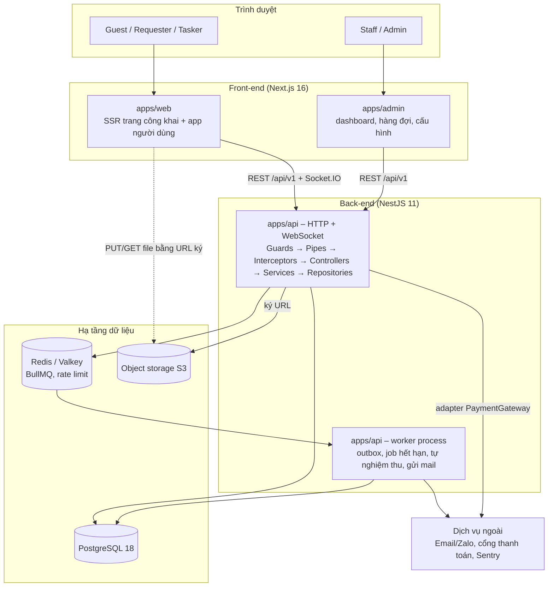
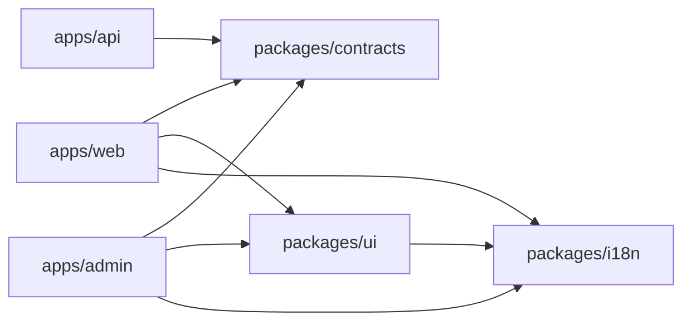
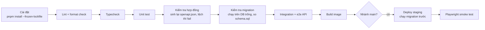

# VIETVI – System Architecture & Codebase Blueprint (v0.1)

| Mục | Nội dung |
| --- | --- |
| Người đọc chính | Tech lead (người dựng repo và các file khởi tạo) |
| Căn cứ | VIETVI Product & Software Requirements v0.1 (SRS), VIETVI Software Design Document v0.1 (SDD), `vietvi_schema_v0_1.sql` |
| Trạng thái | Bản nháp để duyệt. Chưa viết code; tài liệu chỉ chốt kiến trúc, công nghệ, cấu trúc thư mục và quy ước |
| Ngày tra cứu phiên bản | 29/10/2026 (xem mục 16) |
| Đội | 3 người: 2 Front-end, 1 Back-end |

> Mục tiêu của tài liệu: mọi quyết định "khó đổi về sau" được chốt **trước** dòng code đầu tiên, và mỗi quyết định có công cụ tự động giữ nó, để không phát sinh technical debt do mỗi người làm một kiểu.

---

## 1. Tóm tắt các quyết định kiến trúc

| # | Quyết định | Lựa chọn | Lý do chính | Xem lại khi |
| --- | --- | --- | --- | --- |
| D1 | Kiểu kiến trúc | **Modular monolith** (1 API + 1 worker) | 3 người, MVP 6 sprint; tách module theo nghiệp vụ để sau này tách service không phải viết lại | Một module cần scale/deploy độc lập |
| D2 | Tổ chức repo | **Monorepo** pnpm workspaces + Turborepo | Chia sẻ kiểu dữ liệu, schema, cấu hình lint giữa FE và BE trong một PR | Đội > 10 người hoặc tách sản phẩm |
| D3 | Ngôn ngữ | **TypeScript** toàn bộ | Một ngôn ngữ cho 3 app, dùng chung `packages/contracts` | — |
| D4 | Front-end | **Next.js 16** (App Router), 2 app: `web` và `admin` | SEO trang task công khai (SSR); tách admin để giới hạn bề mặt tấn công | Cần app di động native |
| D5 | Back-end | **NestJS 11** (Express adapter mặc định) | Module, DI, Guard/Interceptor sẵn có, khớp cấu trúc SDD | — |
| D6 | Cơ sở dữ liệu | **PostgreSQL 18** | Giữ nguyên index có điều kiện, trigger, unaccent/pg_trgm; có sẵn `uuidv7()` | — |
| D7 | Truy cập DB | **Kysely** (query builder có kiểu) + migration **SQL thuần** | Không để ORM sinh migration làm mất ràng buộc nghiệp vụ trong DB | — |
| D8 | Hợp đồng API | **Contract-first**: Zod schema trong `packages/contracts` → OpenAPI → client sinh tự động cho FE | FE không bị chặn chờ BE (có mock); một nguồn luật kiểm tra dữ liệu | — |
| D9 | Hàng đợi & sự kiện | Redis/Valkey + **BullMQ**, transactional **outbox** trong PostgreSQL | Không mất sự kiện khi gửi thông báo, thanh toán, analytics | Lưu lượng sự kiện rất lớn |
| D10 | Lưu file | Object storage chuẩn **S3** (local: MinIO), truy cập bằng URL ký có hạn | File bàn giao là riêng tư (SRS 7.2) | — |
| D11 | Hạ tầng | Docker image cho từng app; staging + production | Một cách build cho mọi môi trường | Chọn nhà cung cấp (mục 14) |

---

## 2. Ràng buộc và giả định

**Ràng buộc từ SRS**
- Web responsive, ưu tiên điện thoại; **không** làm app native ở MVP.
- Tiếng Việt mặc định, sẵn sàng tiếng Anh; tiền là VND số nguyên; thời gian lưu UTC, hiển thị `Asia/Ho_Chi_Minh`.
- Vai trò: Guest, User (Requester/Tasker theo ngữ cảnh), Staff, Admin.
- Bắt buộc: OTP email, audit log không sửa được, kiểm quyền sở hữu (chống IDOR), idempotency cho thao tác tiền và chấp nhận offer, file riêng tư.

**Ràng buộc đội**
- 3 người: **FE-A** (Thien), **FE-B**, **BE**. Không có DevOps riêng → hạ tầng phải đơn giản, chạy được bằng Docker Compose.
- Chỉ một người Back-end → rủi ro "bus factor = 1" (xem mục 15). Kiến trúc phải cho phép FE làm việc độc lập với BE qua mock sinh từ hợp đồng API.

**Giả định cần xác nhận** (ảnh hưởng hạ tầng, không ảnh hưởng cấu trúc code)
- Nhà cung cấp hạ tầng và nơi lưu dữ liệu (trong nước hay không) — chưa chốt.
- Mô hình thanh toán A (cổng) hay B (đối soát tay) — code thiết kế adapter cho cả hai.

---

## 3. Kiến trúc tổng thể

### 3.1 Sơ đồ thành phần



### 3.2 Hai luồng bắt buộc mọi module tuân theo

**Luồng ghi (đổi trạng thái):** trong **một** giao dịch DB → kiểm quyền (Policy) → kiểm bước chuyển trạng thái (StateMachine) → ghi dữ liệu → ghi `*_status_history` → ghi `audit_logs` → ghi `outbox_events` → COMMIT. Không gửi email, gọi cổng thanh toán hay đẩy socket **trong** giao dịch.

**Luồng sự kiện:** worker đọc `outbox_events` chưa phát → tạo notification / gửi email / đẩy socket / ghi analytics → đánh dấu `published_at`. Nhờ vậy nếu nghiệp vụ rollback thì không có thông báo "ma", và nếu gửi mail lỗi thì nghiệp vụ không bị hỏng.

### 3.3 Một codebase API, hai tiến trình

`apps/api` build ra một image, chạy hai lệnh khác nhau:
- `api`: phục vụ HTTP + WebSocket, **không** chạy job định kỳ.
- `worker`: chỉ chạy BullMQ processor và job định kỳ, **không** mở cổng HTTP công khai.

Lý do: dùng chung module và repository (không lặp code), nhưng scale và khởi động lại độc lập.

---

## 4. Tech stack và phiên bản

### 4.1 Chính sách phiên bản (chống "mỗi người một bản")

1. Phiên bản **major** được chốt trong tài liệu này và trong `pnpm-workspace.yaml` (mục `catalog:`) — mọi app dùng chung một bản React, TypeScript, Zod…
2. Phiên bản **chính xác** nằm trong `pnpm-lock.yaml` (bắt buộc commit). CI cài bằng `pnpm install --frozen-lockfile`.
3. Node.js chốt bằng `.node-version` + trường `engines` + `packageManager` trong `package.json` gốc.
4. Cập nhật thư viện qua **Renovate** (PR tự động theo lịch tuần), không cập nhật tay rải rác.
5. Bản mới phát hành chưa đủ 24 giờ không được cài (mặc định an toàn chuỗi cung ứng của pnpm 11; giữ nguyên, không tắt).

### 4.2 Bảng công nghệ

| Lớp | Công nghệ | Phiên bản chốt | Ghi chú lựa chọn |
| --- | --- | --- | --- |
| Runtime | Node.js | **26 LTS** | Vào Active LTS 28/10/2026, hết hỗ trợ 30/4/2029. Nếu nhà cung cấp hạ tầng chưa có image 26 thì tạm dùng 24 LTS và nâng trong năm 2027 |
| Package manager | pnpm | **11.x** | Workspaces, `catalog:`, mặc định an toàn chuỗi cung ứng |
| Build orchestration | Turborepo | mới nhất\* | Cache build/test/lint theo package |
| Ngôn ngữ | TypeScript | **6.0** | TS 7 (bản Go) đã phát hành nhưng chưa phải mọi công cụ hỗ trợ; nâng khi typescript-eslint và Nest CLI xác nhận tương thích |
| FE framework | Next.js | **16.x** + React 19 | App Router, Turbopack mặc định |
| FE styling | Tailwind CSS | **4.x** | Cấu hình CSS-first, theme đặt trong `packages/ui` |
| FE components | shadcn/ui (Radix) | theo CLI | Copy component vào `packages/ui`, không cài như dependency đóng |
| FE server state | TanStack Query | mới nhất\* | Cache, phân trang, invalidate sau mutation |
| FE client state | Zustand | mới nhất\* | Chỉ trạng thái giao diện; dữ liệu server không để ở đây |
| FE form | React Hook Form + Zod | mới nhất\* | Schema lấy từ `packages/contracts` |
| FE i18n | next-intl | mới nhất\* | `vi` mặc định |
| FE realtime | socket.io-client | cùng major với server | Chat order, thông báo |
| FE API client | Orval | mới nhất\* | Sinh hook TanStack Query + mock MSW từ OpenAPI |
| FE mock | MSW | mới nhất\* | FE chạy được khi BE chưa xong endpoint |
| BE framework | NestJS | **11.x** | Express 5 adapter mặc định |
| BE validation | Zod + nestjs-zod | cùng bản Zod với FE | Cùng schema với FE; sinh OpenAPI |
| BE API docs | @nestjs/swagger | khớp Nest 11 | Xuất `openapi.json` để FE sinh client |
| BE DB access | Kysely + `pg` | mới nhất\* | Query có kiểu; kiểu bảng sinh bằng kysely-codegen |
| BE migration | dbmate | mới nhất\* | Migration SQL thuần `up`/`down`, đánh số theo thời gian |
| BE queue | BullMQ | mới nhất\* | Job, retry, lịch định kỳ |
| BE realtime | Socket.IO (@nestjs/websockets) | khớp Nest 11 | Room theo order và theo user |
| BE auth | @nestjs/jwt + cookie httpOnly | khớp Nest 11 | Access 15 phút, refresh xoay vòng lưu hash |
| BE logging | pino (nestjs-pino) | mới nhất\* | Log JSON, có correlation ID |
| Cơ sở dữ liệu | PostgreSQL | **18** | Extension: pgcrypto, citext, unaccent, pg_trgm |
| Cache/queue store | Redis hoặc Valkey | bản stable hiện hành | Chỉ dùng cho queue, rate limit, cache ngắn hạn; **không** là nguồn sự thật |
| Object storage | S3-compatible (MinIO ở local) | — | Hai bucket: `public`, `private` |
| Email local | Mailpit | — | Bắt mọi email OTP khi dev |
| Test FE & packages | Vitest + Testing Library | mới nhất\* | |
| Test BE | Jest + Supertest | theo Nest | Giữ mặc định Nest để giảm cấu hình |
| Test E2E | Playwright | mới nhất\* | Kịch bản mục 15.2 SRS |
| Lint/format | ESLint (flat config) + typescript-eslint + Prettier | mới nhất\* | Một cấu hình chung trong `packages/config-eslint` |
| Ranh giới module | eslint-plugin-boundaries | mới nhất\* | Chặn import sai tầng (mục 12) |
| Git hooks | Husky + lint-staged + commitlint | mới nhất\* | |
| Giám sát lỗi | Sentry SDK cho Next.js và Node | mới nhất\* | FE và BE |
| Cập nhật thư viện | Renovate (GitHub App) | — | |

Cột "Phiên bản chốt": các dòng in đậm đã được tra cứu ngày 29/10/2026 (mục 16), "x" nghĩa là chốt major, minor/patch do lockfile quyết định. \*"Mới nhất" nghĩa là tech lead lấy bản stable mới nhất **tại ngày khởi tạo repo**, kiểm tra tương thích với Node 26 / Next 16 / Nest 11, rồi ghi major đó vào `catalog:` và vào bảng này. Sau ngày đó, mọi thay đổi major đi qua Renovate + một PR riêng.

---

## 5. Công cụ cần cài trên máy

### 5.1 Cả 3 người

| Công cụ | Ghi chú |
| --- | --- |
| Git ≥ 2.40 | Cấu hình `core.autocrlf=input` (Windows) để tránh lệch xuống dòng |
| Node.js 26 LTS | Cài qua **fnm** hoặc **nvm**; repo có `.node-version` để tự chọn đúng bản |
| Corepack | `corepack enable` → pnpm đúng phiên bản theo `packageManager` |
| Docker Desktop (hoặc OrbStack/Colima) | Chạy PostgreSQL, Redis, MinIO, Mailpit bằng Compose |
| VS Code | Extension bắt buộc nằm trong `.vscode/extensions.json`: ESLint, Prettier, Tailwind CSS IntelliSense, EditorConfig, Docker, Mermaid preview, GitLens (tùy chọn) |

### 5.2 Riêng Back-end

| Công cụ | Ghi chú |
| --- | --- |
| Client PostgreSQL (TablePlus, DBeaver hoặc `psql`) | Xem dữ liệu local |
| dbmate | Cài qua npm devDependency trong `apps/api`, không cài global |
| Công cụ gọi API (Bruno hoặc Postman) | Bộ request lưu trong `apps/api/http/` nếu dùng Bruno (file text, commit được) |

### 5.3 Riêng Front-end

| Công cụ | Ghi chú |
| --- | --- |
| React Developer Tools, TanStack Query Devtools | Trình duyệt |
| Trình giả lập điện thoại (Chrome DevTools device mode) | Kiểm tra mobile-first |

---

## 6. Cấu trúc thư mục

### 6.1 Cây thư mục gốc

```text
vietvi/
├── .github/
│   ├── workflows/
│   │   ├── ci.yml                    # lint, typecheck, test, build cho mọi PR
│   │   └── deploy-staging.yml        # build image + deploy khi merge vào main
│   ├── CODEOWNERS                    # ai duyệt thư mục nào (mục 7)
│   ├── pull_request_template.md
│   └── ISSUE_TEMPLATE/
│       ├── bug_report.md
│       └── feature_request.md
├── .husky/
│   ├── pre-commit                    # lint-staged
│   └── commit-msg                    # commitlint
├── .vscode/
│   ├── extensions.json               # extension bắt buộc
│   └── settings.json                 # format on save, eslint flat config
├── apps/
│   ├── web/                          # Next.js – Guest, Requester, Tasker
│   ├── admin/                        # Next.js – Staff, Admin
│   └── api/                          # NestJS – HTTP API + worker
├── packages/
│   ├── contracts/                    # Zod schema, enum trạng thái, mã lỗi, client API sinh tự động
│   ├── ui/                           # component shadcn/ui + theme Tailwind dùng chung
│   ├── i18n/                         # từ điển vi/en, định dạng tiền và ngày
│   ├── config-eslint/                # cấu hình ESLint dùng chung
│   └── config-typescript/            # tsconfig gốc: base, nextjs, nestjs, library
├── infra/
│   ├── compose/
│   │   └── docker-compose.yml        # postgres, redis, minio, mailpit cho local
│   ├── docker/
│   │   ├── api.Dockerfile
│   │   ├── web.Dockerfile
│   │   └── admin.Dockerfile
│   └── scripts/                      # script tiện ích: reset DB local, seed, tạo bucket
├── docs/
│   ├── architecture/
│   │   └── ARCHITECTURE.md           # chính file này
│   ├── adr/                          # Architecture Decision Records, mỗi quyết định một file
│   │   ├── 0000-template.md
│   │   ├── 0001-modular-monolith.md
│   │   ├── 0002-monorepo-pnpm-turborepo.md
│   │   ├── 0003-kysely-and-sql-migrations.md
│   │   ├── 0004-contract-first-api.md
│   │   └── 0005-outbox-for-side-effects.md
│   ├── srs/                          # SRS v0.1
│   ├── sdd/                          # SDD v0.1 + hình
│   ├── api/
│   │   └── openapi.json              # snapshot hợp đồng API, review được trong PR
│   └── runbooks/                     # khởi động local, deploy, rollback, xử lý sự cố
├── .editorconfig
├── .gitignore
├── .dockerignore
├── .prettierignore
├── .prettierrc
├── .node-version                     # 26
├── .npmrc                            # cấu hình registry nếu cần
├── commitlint.config.mjs
├── eslint.config.mjs                 # gọi packages/config-eslint
├── package.json                      # script gốc, engines, packageManager
├── pnpm-workspace.yaml               # khai báo apps/*, packages/* và catalog phiên bản
├── pnpm-lock.yaml                    # BẮT BUỘC commit
├── renovate.json
├── turbo.json                        # pipeline build/lint/test/typecheck
├── CONTRIBUTING.md                   # quy trình nhánh, commit, PR (mục 8)
└── README.md                         # chạy local trong 5 phút
```

### 6.2 `apps/web` – ứng dụng người dùng

```text
apps/web/
├── public/                           # favicon, ảnh tĩnh, robots.txt
├── src/
│   ├── app/                          # App Router – CHỈ chứa route, layout, page mỏng
│   │   ├── (public)/                 # Guest: trang chủ, duyệt task, chi tiết task, hồ sơ công khai, FAQ – SSR, index được
│   │   ├── (auth)/                   # đăng nhập OTP
│   │   ├── (app)/                    # cần đăng nhập: đăng task, My Tasks, My Work, Order Workspace, hồ sơ, thông báo – noindex
│   │   ├── api/                      # route handler tối thiểu (health) – không đặt logic nghiệp vụ
│   │   ├── layout.tsx
│   │   └── not-found.tsx
│   ├── features/                     # mỗi nghiệp vụ một thư mục, khớp module ở back-end
│   │   ├── auth/
│   │   ├── profile/
│   │   ├── task/
│   │   ├── offer/
│   │   ├── order/                    # workspace, chat, bàn giao, nghiệm thu
│   │   ├── review/
│   │   ├── verification/
│   │   ├── report/
│   │   └── notification/
│   │       ├── components/           # UI riêng của nghiệp vụ
│   │       ├── hooks/                # gọi hook API sinh từ contracts, thêm logic hiển thị
│   │       └── index.ts              # chỉ export những gì route cần
│   ├── components/                   # component dùng chung TRONG web (layout, header, empty state)
│   ├── hooks/                        # useSession, useRoleContext, useSocket
│   ├── stores/                       # Zustand: bộ lọc, ngữ cảnh Requester/Tasker
│   ├── lib/                          # http client, xử lý mã lỗi, format VND và giờ VN
│   ├── mocks/                        # bật MSW khi NEXT_PUBLIC_API_MOCK=true
│   └── styles/                       # globals.css import theme từ packages/ui
├── tests/
│   ├── unit/
│   └── e2e/                          # Playwright
├── .env.example
├── next.config.ts
├── package.json
└── tsconfig.json
```

### 6.3 `apps/admin` – ứng dụng vận hành

Giống `apps/web`, khác ở `src/app/` và `src/features/`:

```text
apps/admin/src/
├── app/
│   ├── (auth)/
│   └── (console)/                    # dashboard, verifications, reports, disputes, users, categories, fee-rules, settings, faq, audit-logs, payments
└── features/
    ├── dashboard/
    ├── verification/
    ├── report/
    ├── dispute/
    ├── user/
    ├── master-data/
    ├── payment/
    ├── settings/
    ├── faq/
    └── audit/
```

Admin không bao giờ được index (header `X-Robots-Tag: noindex` cho toàn app) và nên chạy ở domain con riêng.

### 6.4 `apps/api` – NestJS

```text
apps/api/
├── src/
│   ├── main.ts                       # khởi động HTTP + WebSocket
│   ├── worker.ts                     # khởi động worker (không mở HTTP)
│   ├── app.module.ts
│   ├── config/                       # đọc và kiểm tra biến môi trường bằng Zod khi khởi động
│   ├── common/                       # xuyên suốt, không chứa nghiệp vụ
│   │   ├── guards/                   # JwtGuard, RolesGuard
│   │   ├── policies/                 # base policy chống IDOR
│   │   ├── interceptors/             # IdempotencyInterceptor, CorrelationIdInterceptor
│   │   ├── filters/                  # GlobalExceptionFilter → mã lỗi chuẩn
│   │   ├── pipes/                    # ZodValidationPipe
│   │   ├── decorators/               # @CurrentUser, @Roles, @Idempotent
│   │   └── state-machine/            # helper kiểm bước chuyển trạng thái
│   ├── infra/                        # adapter hạ tầng, nghiệp vụ chỉ gọi qua interface
│   │   ├── db/                       # Kysely instance, transaction helper, kiểu sinh từ DB
│   │   ├── queue/                    # BullMQ queues
│   │   ├── storage/                  # S3 signed URL
│   │   ├── mail/                     # SMTP/API email, Zalo (sau)
│   │   ├── payment/                  # PaymentGateway + PayOS/VNPAY/Manual adapter
│   │   ├── realtime/                 # Socket.IO adapter (Redis adapter khi chạy nhiều bản)
│   │   ├── outbox/                   # ghi và đọc outbox_events
│   │   └── audit/                    # AuditService
│   ├── modules/                      # khớp 1-1 với mục 2.x của SDD
│   │   ├── auth/
│   │   ├── profile/
│   │   ├── master-data/
│   │   ├── file/
│   │   ├── task/
│   │   ├── offer/
│   │   ├── order/                    # order, delivery, chat
│   │   ├── payment/                  # payment, ledger, fee rule
│   │   ├── trust/                    # review, verification, user_stats
│   │   ├── moderation/               # report, dispute, moderation action
│   │   ├── notification/
│   │   └── admin/                    # dashboard, users, roles, settings, faq
│   │       ├── controllers/
│   │       ├── services/
│   │       ├── repositories/         # CHỈ module này được truy vấn bảng của nó
│   │       ├── policies/
│   │       ├── dto/                  # dùng lại schema từ packages/contracts
│   │       ├── events/               # tên + payload sự kiện outbox module này phát ra
│   │       ├── <module>.module.ts
│   │       └── index.ts              # public API của module cho module khác gọi
│   └── jobs/                         # processor cho worker: outbox-dispatcher, task-expiry, order-auto-complete, file-scan, stats-recompute
├── db/
│   ├── migrations/                   # dbmate: 20261101120000_init_schema.sql (up/down)
│   ├── seeds/                        # danh mục, trường học, kỹ năng, tài khoản admin local
│   └── schema.sql                    # dbmate tự xuất sau mỗi migration – review diff trong PR
├── http/                             # bộ request Bruno (nếu dùng)
├── test/
│   ├── unit/                         # state machine, fee calculator, policy
│   ├── integration/                  # repository + DB thật (Testcontainers hoặc DB test)
│   └── e2e/                          # Supertest theo luồng nghiệp vụ
├── .env.example
├── nest-cli.json
├── package.json
└── tsconfig.json
```

Migration đầu tiên chính là nội dung `vietvi_schema_v0_1.sql` đã kiểm tra, tách thành file `up`/`down` theo định dạng dbmate.

### 6.5 `packages/contracts` – hợp đồng giữa FE và BE

```text
packages/contracts/
├── src/
│   ├── schemas/                      # Zod schema theo module: task.ts, offer.ts, order.ts...
│   ├── enums/                        # TaskStatus, OrderStatus, PaymentStatus... (khớp CHECK trong DB)
│   ├── errors/                       # danh sách mã lỗi chuẩn: TASK_NOT_OPEN, OFFER_NOT_ELIGIBLE...
│   ├── money.ts                      # kiểu VND số nguyên, hàm format
│   └── index.ts
├── generated/                        # client + hook + mock do Orval sinh – KHÔNG commit (mục 10)
├── orval.config.ts
└── package.json
```

### 6.6 Quy tắc phụ thuộc giữa các package



- `apps/*` **không** import lẫn nhau. `apps/web` không import gì từ `apps/api` và ngược lại.
- `packages/contracts` **không** phụ thuộc React, NestJS hay Kysely — chỉ Zod và TypeScript thuần, để cả hai phía dùng được.
- `packages/ui` không gọi API.
- Trong `apps/api`: `controllers → services → repositories → infra/db`. Module A chỉ gọi module B qua `modules/b/index.ts` (service công khai) hoặc qua sự kiện outbox, **không** import repository của B.

---

## 7. Phân công và quyền sở hữu thư mục

| Người | Phạm vi chính | Thư mục sở hữu | Ghi chú |
| --- | --- | --- | --- |
| **FE-A (Thien)** | Ứng dụng người dùng: duyệt task, đăng task, offer, Order Workspace, hồ sơ, thông báo | `apps/web`, `packages/i18n` | Chủ trì luồng giao dịch phía người dùng |
| **FE-B** | Ứng dụng vận hành + thư viện giao diện | `apps/admin`, `packages/ui`, `packages/config-eslint` | Giữ design system thống nhất cho cả web và admin |
| **BE** | API, worker, DB, hạ tầng | `apps/api`, `infra/`, `packages/config-typescript` | Viết migration, hợp đồng API, outbox, thanh toán |
| **Chung** (BE chủ trì, 1 FE duyệt) | Hợp đồng API | `packages/contracts`, `docs/api/openapi.json` | Mọi thay đổi hợp đồng phải có 1 người FE duyệt |
| **Tech lead** | Kiến trúc, quy ước, CI | `docs/`, `.github/`, file cấu hình gốc | Duyệt mọi ADR |

Bản nháp nội dung `.github/CODEOWNERS` (thay `@...` bằng tài khoản GitHub thật):

```text
*                              @tech-lead
/apps/web/                     @fe-a
/apps/admin/                   @fe-b
/packages/ui/                  @fe-b
/packages/i18n/                @fe-a
/apps/api/                     @be
/infra/                        @be @tech-lead
/packages/contracts/           @be @fe-a @fe-b
/docs/api/openapi.json         @be @fe-a @fe-b
/apps/api/db/migrations/       @be @tech-lead
/docs/adr/                     @tech-lead
/.github/                      @tech-lead
```

**Cách làm song song khi chỉ có 1 BE:**
1. BE viết schema Zod và endpoint rỗng trước (trả 501) → xuất `openapi.json`.
2. Orval sinh hook và mock MSW → FE làm giao diện với dữ liệu giả ngay.
3. BE hoàn thiện logic theo thứ tự ưu tiên vòng giao dịch: auth → task → offer → order → trust → moderation → payment.
4. FE tắt mock theo từng endpoint khi BE xong.

---

## 8. Quy ước

### 8.1 Git và nhánh

- **Trunk-based**: `main` luôn deploy được lên staging; nhánh tính năng sống ≤ 3 ngày.
- Tên nhánh: `<loại>/<mã-việc>-<mô-tả-ngắn>` → `feat/VV-42-offer-submit`, `fix/VV-57-otp-expiry`.
- `main` được bảo vệ: cấm push thẳng, bắt buộc PR, CI xanh, ≥ 1 người duyệt theo CODEOWNERS, squash merge.
- Production triển khai bằng tag `vX.Y.Z` trên `main`.

### 8.2 Commit

Conventional Commits, scope là app hoặc module:

```text
feat(api/offer): chặn offer trùng bằng unique index
fix(web/order): sửa nút nghiệm thu bấm đúp
chore(deps): nâng next lên 16.x
docs(adr): 0003 chọn Kysely
```

Loại cho phép: `feat`, `fix`, `refactor`, `perf`, `test`, `docs`, `chore`, `ci`, `build`, `revert`.

### 8.3 Pull request

- PR ≤ ~400 dòng thay đổi (không tính file sinh tự động); lớn hơn thì chia nhỏ.
- Template PR bắt buộc có: mã yêu cầu SRS liên quan, ảnh chụp màn hình (FE), migration có không, thay đổi hợp đồng API có không, cách kiểm thử.
- PR đổi `packages/contracts` hoặc `db/migrations` phải ghi rõ ảnh hưởng ngược (breaking hay không).

### 8.4 Đặt tên

| Đối tượng | Quy ước | Ví dụ |
| --- | --- | --- |
| Thư mục, file TS | kebab-case | `offer-policy.ts`, `order-workspace/` |
| React component | PascalCase (tên file kebab-case) | `TaskCard` trong `task-card.tsx` |
| Class NestJS | PascalCase + hậu tố vai trò | `OfferService`, `OfferRepository`, `OfferPolicy` |
| Bảng, cột DB | snake_case, bảng số nhiều | `task_status_history.to_status` |
| JSON API | camelCase | `agreedPrice`, `dueAt` |
| Enum trạng thái | UPPER_SNAKE | `REVISION_REQUESTED` |
| Biến môi trường | UPPER_SNAKE, FE công khai có tiền tố `NEXT_PUBLIC_` | `DATABASE_URL`, `NEXT_PUBLIC_API_URL` |
| Sự kiện outbox | snake_case quá khứ | `offer_accepted`, `order_completed` |

### 8.5 API

- Tiền tố `/api/v1`; tài nguyên số nhiều: `/tasks/:id/offers`, `/offers/:id/accept`.
- Thời gian: chuỗi ISO 8601 UTC. Tiền: số nguyên VND, không gửi số thập phân.
- Phân trang: cursor (`?cursor=&limit=`), trả `{ items, nextCursor }`.
- Lỗi luôn có dạng `{ code, message, details?, correlationId }`; `code` lấy từ `packages/contracts/errors`. FE hiển thị theo `code`, không theo `message`.
- Thao tác tạo tiền hoặc chấp nhận (accept offer, complete order, payment, payout) bắt buộc header `Idempotency-Key`.
- Đổi hợp đồng theo kiểu không phá vỡ (thêm trường tùy chọn). Phá vỡ → endpoint mới hoặc `/api/v2`.

### 8.6 Cơ sở dữ liệu

- Mọi thay đổi schema đi qua migration; **cấm** sửa DB bằng tay trên staging/production.
- Migration đã merge thì **không sửa**; sai thì viết migration mới.
- Mỗi migration có `down` (trừ khi xóa dữ liệu không đảo được — ghi rõ trong PR).
- Ràng buộc nghiệp vụ quan trọng phải nằm ở DB (unique index có điều kiện, CHECK), không chỉ ở code.
- Khóa chính UUID sinh bằng `uuidv7()` của PostgreSQL 18 hoặc tầng ứng dụng — chọn một cách và ghi vào ADR.

### 8.7 Định nghĩa "xong" (Definition of Done)

- [ ] Có test cho máy trạng thái / policy / tính tiền nếu chạm vào.
- [ ] Lint, typecheck, test xanh trên CI.
- [ ] Hợp đồng API cập nhật (`openapi.json` đổi trong cùng PR) nếu đổi endpoint.
- [ ] Thao tác đổi trạng thái có ghi history + audit + outbox.
- [ ] Không có chuỗi giao diện viết cứng ngoài file i18n.
- [ ] Có `noindex` cho trang riêng tư; kiểm tra quyền truy cập bằng tài khoản không liên quan.

---

## 9. Môi trường và cấu hình

### 9.1 Dịch vụ chạy local (Docker Compose)

| Dịch vụ | Image | Cổng | Mục đích |
| --- | --- | --- | --- |
| postgres | `postgres:18` | 5432 | DB chính + DB test riêng |
| redis | `redis` hoặc `valkey/valkey` | 6379 | BullMQ, rate limit |
| minio | `minio/minio` | 9000 (API), 9001 (console) | Object storage giả lập S3 |
| mailpit | `axllent/mailpit` | 1025 (SMTP), 8025 (giao diện) | Xem email OTP |

Ứng dụng chạy trên máy (không trong Docker) khi dev: `web` cổng 3000, `admin` cổng 3001, `api` cổng 4000.

### 9.2 Biến môi trường (tên khóa, không có giá trị)

**`apps/api/.env.example`**

| Nhóm | Khóa |
| --- | --- |
| Chung | `NODE_ENV`, `PORT`, `LOG_LEVEL`, `APP_URL_WEB`, `APP_URL_ADMIN`, `CORS_ORIGINS`, `COOKIE_DOMAIN` |
| DB | `DATABASE_URL`, `DATABASE_URL_TEST` |
| Redis | `REDIS_URL` |
| Auth | `JWT_ACCESS_SECRET`, `JWT_ACCESS_TTL`, `REFRESH_TOKEN_TTL`, `OTP_TTL_SECONDS`, `OTP_MAX_ATTEMPTS` |
| Storage | `S3_ENDPOINT`, `S3_REGION`, `S3_ACCESS_KEY`, `S3_SECRET_KEY`, `S3_BUCKET_PUBLIC`, `S3_BUCKET_PRIVATE`, `UPLOAD_MAX_MB` |
| Email | `MAIL_FROM`, `SMTP_HOST`, `SMTP_PORT`, `SMTP_USER`, `SMTP_PASS` |
| Thanh toán | `PAYMENT_MODE` (`GATEWAY` hoặc `MANUAL`), `PAYMENT_PROVIDER`, khóa của nhà cung cấp được chọn |
| Giám sát | `SENTRY_DSN` |

**`apps/web/.env.example`** và **`apps/admin/.env.example`**: `NEXT_PUBLIC_SITE_URL`, `NEXT_PUBLIC_API_URL`, `NEXT_PUBLIC_WS_URL`, `NEXT_PUBLIC_SENTRY_DSN`, `NEXT_PUBLIC_API_MOCK`.

Quy tắc:
- Biến `NEXT_PUBLIC_*` bị đóng gói vào trình duyệt → **không bao giờ** chứa bí mật.
- API kiểm tra toàn bộ biến bằng Zod lúc khởi động; thiếu hoặc sai kiểu thì dừng ngay, không chạy "nửa vời".
- Chỉ commit `.env.example`. Bí mật staging/production lưu ở GitHub Environments secrets hoặc secret manager của nhà cung cấp.

### 9.3 Các môi trường

| Môi trường | Cách triển khai | Dữ liệu |
| --- | --- | --- |
| local | Compose cho hạ tầng, app chạy bằng `pnpm dev` | Seed giả |
| CI | Service container PostgreSQL + Redis trong GitHub Actions | Tạo mới mỗi lần chạy |
| staging | Tự deploy khi merge `main` | Seed giả, không dùng dữ liệu thật |
| production | Deploy theo tag `vX.Y.Z`, có bước duyệt tay | Thật; sao lưu tự động hằng ngày + kiểm tra khôi phục định kỳ |

---

## 10. Những gì không được commit

### 10.1 `.gitignore` (gốc repo)

```gitignore
# Dependencies
node_modules/
.pnpm-store/

# Build output
dist/
build/
out/
.next/
.turbo/
*.tsbuildinfo
next-env.d.ts

# Code sinh tự động (sinh lại bằng `pnpm gen`)
packages/contracts/generated/

# Test & coverage
coverage/
playwright-report/
test-results/
blob-report/
.vitest-cache/

# Biến môi trường và bí mật
.env
.env.*
!.env.example
*.pem
*.key
*.p12
secrets/

# Dữ liệu local
infra/compose/data/
*.dump
*.sql.gz
uploads/
tmp/

# Log
logs/
*.log
npm-debug.log*
pnpm-debug.log*

# Hệ điều hành và IDE
.DS_Store
Thumbs.db
.idea/
.vscode/*
!.vscode/extensions.json
!.vscode/settings.json

# Triển khai
.vercel/
```

**Bắt buộc commit** (hay bị bỏ nhầm): `pnpm-lock.yaml`, `.env.example` của từng app, `docs/api/openapi.json`, `apps/api/db/schema.sql`, kiểu DB sinh bởi kysely-codegen trong `apps/api/src/infra/db/`, `.vscode/extensions.json`, `.vscode/settings.json`.

Lý do commit `openapi.json` và `schema.sql` dù là file sinh: người duyệt PR nhìn thấy ngay thay đổi hợp đồng API và thay đổi DB. Client Orval thì không commit vì sinh lại được hoàn toàn từ `openapi.json`.

### 10.2 `.dockerignore`

```gitignore
.git
.github
.husky
.vscode
.idea
**/node_modules
**/.next
**/.turbo
**/dist
**/coverage
**/playwright-report
**/test-results
**/.env
**/.env.*
!**/.env.example
docs/
infra/compose/data/
*.md
```

### 10.3 `.prettierignore` và phạm vi ESLint

```gitignore
pnpm-lock.yaml
**/generated/
**/.next/
**/dist/
**/coverage/
apps/api/db/schema.sql
apps/api/db/migrations/
docs/api/openapi.json
```

ESLint bỏ qua cùng danh sách trên, khai báo trong `eslint.config.mjs` (mục `ignores`), không dùng file `.eslintignore` riêng.

---

## 11. CI/CD



- Turborepo chỉ chạy lại phần bị ảnh hưởng bởi thay đổi (`--filter=...[origin/main]`).
- Bước E và F là hai bước chống nợ kỹ thuật quan trọng nhất: hợp đồng API và schema DB không thể lệch với code mà không ai biết.
- Production: tạo tag → chạy lại pipeline → bước duyệt tay → migration → deploy API và worker → deploy web/admin.

---

## 12. Hàng rào chống technical debt

Mỗi quy tắc đều có công cụ tự động giữ; quy tắc chỉ dựa vào trí nhớ sẽ bị quên.

| Quy tắc | Công cụ giữ |
| --- | --- |
| App không import lẫn nhau; module API không import repository của module khác | `eslint-plugin-boundaries` + CI |
| Một phiên bản thư viện cho cả monorepo | `catalog:` trong `pnpm-workspace.yaml`, Renovate |
| FE và BE dùng chung luật kiểm tra dữ liệu | Zod trong `packages/contracts`; CI bước E |
| Schema DB chỉ đổi qua migration | CI bước F; quyền DB production không cấp cho người |
| Ràng buộc nghiệp vụ không chỉ nằm ở code | Unique index có điều kiện, CHECK, trigger (đã có trong schema v0.1) |
| Không có chuỗi tiếng Việt viết cứng trong component | Rule ESLint chặn literal string trong JSX ở `apps/*/src/features` |
| Không gọi dịch vụ ngoài trong giao dịch DB | Review + quy ước outbox; test tích hợp cho mỗi luồng tiền |
| Không lộ bí mật ra trình duyệt | Chỉ `NEXT_PUBLIC_*` vào client; secret scanning của GitHub |
| Mỗi quyết định lớn có lý do được ghi lại | ADR trong `docs/adr/`, tech lead duyệt |
| Thư viện không lỗi thời âm thầm | Renovate hằng tuần; pnpm audit trong CI |
| Commit và PR đọc được về sau | commitlint, PR template, squash merge |

---

## 13. Checklist Sprint 0 cho tech lead

Thứ tự tạo file, chưa viết code nghiệp vụ:

**Bước 1 – Khung repo**
- [ ] Tạo repo, bật bảo vệ nhánh `main`, bật secret scanning và Dependabot alerts.
- [ ] `package.json` gốc (`packageManager`, `engines`), `pnpm-workspace.yaml` (workspaces + `catalog:`), `.node-version`, `.npmrc`.
- [ ] `turbo.json` với các task: `dev`, `build`, `lint`, `typecheck`, `test`, `gen`.
- [ ] `.gitignore`, `.dockerignore`, `.prettierignore`, `.editorconfig`, `.prettierrc` (nội dung mục 10).
- [ ] `.vscode/extensions.json`, `.vscode/settings.json`.

**Bước 2 – Cấu hình dùng chung**
- [ ] `packages/config-typescript` (base, nextjs, nestjs, library).
- [ ] `packages/config-eslint` + `eslint.config.mjs` gốc, gồm rule ranh giới (mục 12).
- [ ] Husky, lint-staged, `commitlint.config.mjs`.

**Bước 3 – Khung ứng dụng (chỉ scaffold, không nghiệp vụ)**
- [ ] `apps/web`, `apps/admin` tạo bằng create-next-app, sắp lại theo mục 6.2–6.3.
- [ ] `apps/api` tạo bằng Nest CLI, sắp lại theo mục 6.4, thêm `worker.ts` rỗng.
- [ ] `packages/contracts`, `packages/ui`, `packages/i18n` với `package.json` và `index.ts` rỗng.
- [ ] `.env.example` cho 3 app theo mục 9.2.

**Bước 4 – Hạ tầng local**
- [ ] `infra/compose/docker-compose.yml` (mục 9.1).
- [ ] Migration đầu tiên từ `vietvi_schema_v0_1.sql`; seed danh mục mẫu và một tài khoản admin local.
- [ ] Script `pnpm db:up`, `pnpm db:reset`, `pnpm gen`.

**Bước 5 – Quy trình**
- [ ] `.github/CODEOWNERS` (mục 7), `pull_request_template.md`, issue templates.
- [ ] `.github/workflows/ci.yml` (mục 11, có thể để bước E/F ở chế độ cảnh báo trong tuần đầu).
- [ ] `renovate.json`.
- [ ] `README.md` (chạy local trong 5 phút), `CONTRIBUTING.md` (mục 8).
- [ ] `docs/adr/0000-template.md` và 5 ADR đầu tiên (D1, D2, D7, D8, D9).

**Tiêu chí hoàn thành Sprint 0:** mỗi người clone repo, chạy `pnpm i && pnpm db:up && pnpm dev`, thấy 3 app khởi động, mở được Mailpit và MinIO console, CI xanh trên một PR thử.

---

## 14. Quyết định còn mở

| # | Câu hỏi | Ảnh hưởng | Cần chốt trước |
| --- | --- | --- | --- |
| Q1 | Nhà cung cấp hạ tầng và nơi lưu dữ liệu (trong nước hay nước ngoài) | Dockerfile không đổi; đổi cách deploy, managed PostgreSQL, S3 | Sprint 2 (trước khi có staging thật) |
| Q2 | Mô hình thanh toán A hay B | Chọn adapter mặc định, `PAYMENT_MODE` | Sprint 4 |
| Q3 | Nhà cung cấp email (và Zalo ZNS sau MVP) | Adapter `infra/mail` | Sprint 1 |
| Q4 | Sinh UUID ở DB (`uuidv7()`) hay ở ứng dụng | Quy ước migration và repository | Sprint 0 (ADR) |
| Q5 | Redis hay Valkey trên môi trường thật | Chỉ đổi image, không đổi code | Sprint 2 |
| Q6 | Domain: `vietvi.vn`, `admin.vietvi.vn`, `api.vietvi.vn` hay khác | Cookie domain, CORS | Sprint 1 |

---

## 15. Rủi ro kiến trúc và cách giảm

| Rủi ro | Mức | Cách giảm |
| --- | --- | --- |
| Chỉ một người BE (vắng là dừng) | Cao | Contract-first + mock để FE không bị chặn; ADR và runbook đủ để FE chạy được API local; FE review PR hợp đồng; cân nhắc FE-B nhận phần admin endpoint đơn giản (FAQ, settings) sau Sprint 2 |
| Hợp đồng API lệch giữa FE và BE | Trung bình | Client sinh tự động; CI bước E |
| Schema DB trôi so với code | Trung bình | Migration bắt buộc; CI bước F; kysely-codegen sinh kiểu từ DB |
| Node 26 vừa vào LTS, thư viện hoặc hosting chưa hỗ trợ | Thấp | Thử ngay ở Sprint 0; fallback Node 24 đã ghi trong mục 4 |
| Nâng TypeScript 7 làm vỡ công cụ lint/build | Thấp | Chốt TS 6.0; nâng bằng một PR riêng khi công cụ xác nhận hỗ trợ |
| Admin và web dùng giao diện lệch nhau | Thấp | Một `packages/ui`, FE-B sở hữu |

---

## 16. Nguồn tra cứu phiên bản (29/10/2026)

- Node.js: lịch phát hành và LTS — [Node.js Release Working Group](https://cdn.jsdelivr.net/gh/nodejs/release@main/README.md), [Evolving the Node.js Release Schedule](https://nodejs.org/en/blog/announcements/evolving-the-nodejs-release-schedule), [endoflife.ai – Node.js](https://endoflife.ai/article-nodejs-eol)
- Next.js 16: [Versio.io – Next.js releases](https://www.versio.io/de/product-release-end-of-life-eol-vercel-nextjs.html)
- NestJS 11: [NestJS guide 2026 (v11.1.x)](https://tech-insider.org/fi/nestjs-opas-tutorial-rest-api-2026/)
- PostgreSQL 18: [PostgreSQL versioning policy](https://www.postgresql.org/support/versioning), [Neon – Postgres version support](https://neon.com/docs/postgresql/postgres-version-support)
- pnpm 11: [pnpm blog](https://pnpm.io/uk/blog/tags/release), [InfoQ – pnpm 11 RC](https://infoq.com/news/2026/04/pnpm-11-rc-release/)
- Tailwind CSS 4: [Tailwind CSS releases](https://releases.sh/tailwind-css/tailwind-css.md)
- TypeScript 6.0 / 7.0: [Visual Studio Magazine – TS 6.0](https://visualstudiomagazine.com/articles/2026/03/23/typescript-6-0-ships-as-final-javascript-based-release-clears-path-for-go-native-7-0.aspx), [Visual Studio Magazine – TS 7.0 RC](https://visualstudiomagazine.com/articles/2026/06/22/typescript-7-0-rc-moves-microsofts-go-rewrite-into-the-mainline-compiler.aspx?p=1)

Các thư viện ghi "mới nhất" trong mục 4.2 chưa được tra cứu trong tài liệu này; tech lead xác nhận phiên bản tại ngày khởi tạo repo.
